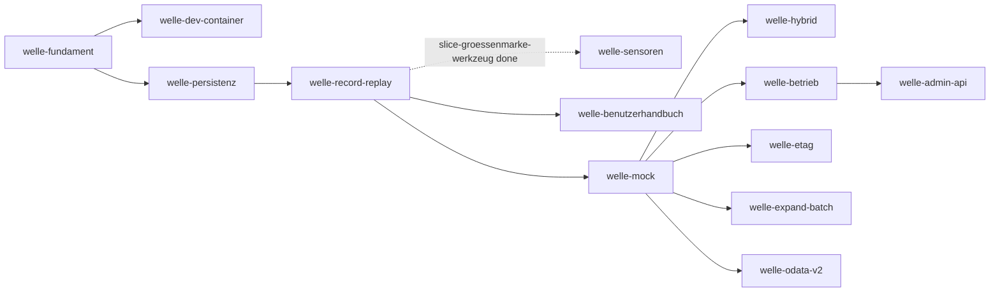

# Roadmap

**Format-Regel:** Die Roadmap ist eine Reihenfolge von **Wellen**,
keine Reihenfolge von Terminen (siehe
Baseline-Regelwerk `modul-06-roadmap.md`).
Termine werden — falls überhaupt — als Konsequenz der Wellen-Schätzung
gezeigt, nicht als Treiber.

---

## Offene Wellen

Regeln dieser Sektion: Baseline-Regelwerk `modul-06-roadmap.md`
§Roadmap-Struktur: fünf Abschnitte — *Offene Wellen* ist **derivativ**: Der
Zustand sind die flachen Welle-Dateien; woran gearbeitet wird, sagt das
`Welle:`-Feld der Slices in `in-progress/`. Ziel, Trigger und
Closure-Kriterien stehen in der Welle-Datei, nicht hier.

- [welle-record-replay](../welle-record-replay.md)
- [welle-dev-container](../welle-dev-container.md)

## Nächste Wellen

Regeln dieser Sektion: Baseline-Regelwerk `modul-06-roadmap.md`
§Roadmap-Struktur: fünf Abschnitte, Bullet *Nächste Wellen* — die geordnete
Vorschau: je Zeile Welle, Trigger als beobachtbare Bedingung, wichtigste Slices
und geschätzter Aufwand (S/M/L, kein Termin).

| Welle | Trigger | Wichtigste Slices | Geschätzter Aufwand |
|---|---|---|---|
| welle-sensoren | `slice-groessenmarke-werkzeug` (Welle record-replay) liegt in `done/` | Prüfung auf unsichtbare Zeichen, Größe der Guide-Dateien als Gate (d-check-Modul `file`), Abdeckungs-Deklaration über den Tests mit erzeugten Tabellen, Schwelle der Anweisungsabdeckung; Plan: [welle-sensoren](../welle-sensoren.md) | M |
| [welle-benutzerhandbuch](../welle-benutzerhandbuch.md) | `slice-groessenmarke-werkzeug` in `done/`; der Abgleich und die Kapitel über Aufzeichnen und Wiedergeben warten auf `slice-bootstrap-m2` in `done/` | Gerüst von docs/user/benutzerhandbuch.md samt Anpassung des Standards, Abgleich der Kataloge (Fehlercodes `ODR-E…`, Konfigurationsschlüssel, Kommandos) zwischen Binary, Spezifikation und Handbuch, Kapitel Aufzeichnen und Wiedergeben mit belegten Beispielen, Probelauf durch eine Rolle ohne Vorwissen | L |
| [welle-mock](../welle-mock.md) | welle-record-replay done (M2 erreicht), `slice-handbuch-meldungskatalog` in `done/` | Parser der OData-URL (Pfad, `$filter`), EDM-Ausdrücke und Interpreter, Codec zum Schreiben und zum Lesen von Client-Bodies, `MockUseCase` (Lesen, Schreiben), Snapshots, Abnahmetests, Modus `mock` im Composition Root | L |
| [welle-hybrid](../welle-hybrid.md) | welle-mock done (M3 erreicht) | Fallback-Policy, `HybridUseCase`, Modus `hybrid` im Composition Root | M |
| [welle-betrieb](../welle-betrieb.md) | welle-mock done (M3 erreicht) | Port `Telemetry` und Einbau in alle Pfade, `AuditLog`, TLS des Listeners, Container-Image mit Neustarttest, Lasttest zu `LH-QA-01` | L |
| [welle-admin-api](../welle-admin-api.md) | welle-betrieb done (M5 erreicht) | `InspectionUseCase`, Admin-Listener mit Token und Transportschutz, Endpunkte für Sessions, Imports, Workspaces und Snapshots, CLI-Kommandos, Sicherheitsnachweis | L |
| [welle-etag](../welle-etag.md) | welle-mock done (M3 erreicht) | ETag, `If-Match` mit `412`, `Prefer` (Soll) | S |
| [welle-expand-batch](../welle-expand-batch.md) | welle-mock done (M3 erreicht) | `$expand`, `$batch` mit atomaren Changesets (Soll) | M |
| [welle-odata-v2](../welle-odata-v2.md) | welle-mock done (M3 erreicht), ADR zum versionierten Adapter `Accepted` | Metadaten, Payload und Query für V2, Wahl des Adapters je Service (Kann) | L |

## Meilensteine

Regeln dieser Sektion: Baseline-Regelwerk `modul-06-roadmap.md`
§Welle ≠ Meilenstein ≠ Release.

| Meilenstein | Welle(n) | Trigger | Status |
|---|---|---|---|
| M1 | welle-fundament | `make gates` fährt Build, Test, Lint und `a-check` auf Go-Code, jedes durch eine Gegenprobe belegt | erreicht — [slice-gegenproben-build-test](../done/slice-gegenproben-build-test.md) |
| M2 | welle-record-replay | Ein Test zeichnet gegen einen Referenzdienst auf und spielt ohne Upstream wieder ab | offen |
| M3 | welle-mock | Ein Test beantwortet aus einer importierten Baseline `$metadata` und Abfragen mit Optionen, ändert und löscht Entities mit sichtbaren Zustandsübergängen, stellt einen Snapshot wieder her und setzt zurück, ohne Upstream | offen |
| M4 | welle-hybrid | Ein Test belegt am Verbindungszähler eines Referenzdienstes, dass im Modus `hybrid` nur freigegebene lesende Anfragen den Upstream erreichen und ein POST ohne Freigabe nie | offen |
| M5 | welle-betrieb | Der Lasttest nach `LH-QA-01.a` läuft reproduzierbar und weist p95 aus dem Gesamtspan für Replay und Mock aus | offen |
| M6 | welle-admin-api | Ein Test steuert Aufzeichnung, Import, Workspace, Snapshot und Reset ausschließlich über den Admin-Listener mit Token und weist Anfragen ohne Token ab | offen |
| M7 | welle-record-replay, welle-mock, welle-hybrid, welle-betrieb, welle-admin-api, welle-dev-container | Erstabnahme: alle Muss-Anforderungen des Lastenhefts haben einen Beleg, der fachliche Owner hat den Zielwert von `LH-QA-01` bestätigt, und das Lastenheft trägt den Status `Accepted` | offen |

## Abhängigkeitsgraph

Regeln dieser Sektion: Baseline-Regelwerk `modul-06-roadmap.md`
§Roadmap-Struktur: fünf Abschnitte, Bullet *Nächste Wellen* — die Abhängigkeit
steht als beobachtbare Bedingung in der `Trigger`-Spalte **und** als gerichtete
Kante hier; eine Welle, die ohne fertige Vorgängerin nicht starten kann, ist
eine Phantom-Welle.

## Abgeschlossene Wellen

Regeln dieser Sektion: Baseline-Regelwerk `modul-06-roadmap.md`
§Roadmap-Struktur: fünf Abschnitte.

| Welle | Abschluss | Closure-Notiz |
|---|---|---|
| welle-fundament | 2026-10-19 | [welle-fundament-results](../done/welle-fundament-results.md) |
| welle-persistenz | 2026-10-20 | [welle-persistenz-results](../done/welle-persistenz-results.md) |

## Historische Trigger-Verschiebungen

Regeln dieser Sektion: Baseline-Regelwerk `modul-06-roadmap.md`
§Roadmap-Struktur: fünf Abschnitte, Bullet *Historische Trigger-Verschiebungen*
— das Drift-Log: jede Umplanung mit Datum, Änderung, Grund. Leer heißt starre
Roadmap, jede Zeile voll heißt treibende.

| Datum | Was wurde geändert? | Warum? |
|---|---|---|
| 2026-10-21 | [welle-record-replay](../welle-record-replay.md): [slice-record-service](../done/slice-record-service.md) vor dem ersten Code-Commit geschnitten; der Adapter `httpupstream` ist [slice-upstream-adapter](../done/slice-upstream-adapter.md), nach `slice-record-service` und vor `slice-bootstrap-m2`; die Welle führt 15 Slices statt 14 | Schätzung rund 4700 Zeilen und drei Schichten (Outbound Port, Dienst, Driven Adapter) in einem Slice; ein Schnitt vor dem Code statt einer Rückführung danach, die bei zehn Überschreitungen keinmal genommen wurde (`BEO-REPO/groessenmarke-ueberschritten-ohne-rueckfuehrung`) |
| 2026-10-21 | [welle-record-replay](../welle-record-replay.md): [slice-upstream-adapter](../done/slice-upstream-adapter.md) beim Handoff geschnitten; die TLS-Konfiguration des Adapters (`CAPEM`, `Pruefen`, HTTP/1.1 über TLS) ist [slice-upstream-tls](../done/slice-upstream-tls.md), nach `slice-upstream-adapter` und vor `slice-bootstrap-m2`; die Welle führt 16 Slices statt 15 | Handoff 2831 Zeilen über der Schwelle 2500 aus §4 des Plans; ohne Schnitt hielte die Marke 2900 nur bei höchstens 69 Zeilen Zuwachs im Review, gemessen waren in den Vorgängern 12,3 und 16,1 %; der Schnitt war vorab benannt und durch die Auflage (TLS-Teil zuletzt, in eigenem Commit) nach dem Code nehmbar |
| 2026-10-21 | [welle-record-replay](../welle-record-replay.md): [slice-race-gate](../done/slice-race-gate.md) neu, vor `slice-http-adapter`, dessen Start ihn in `done/` verlangt; [slice-protokolltreue](../open/slice-protokolltreue.md) neu, nach `slice-bootstrap-m2` als letzter Slice; die Welle führt 18 Slices statt 16 | Entscheidung des Users zu den Beobachtungen über der Schwelle: `BEO-REPO/nebenlaeufiger-lauf-nur-im-glueck-gruen` (5×) bekommt den Ausgang `geplant` mit einem Race-Detektor im Gate; der Vergleichstest der Messmethode von `LH-QA-07` hatte in der Welle keinen Träger, und `slice-bootstrap-m2` bleibt beim Satz von M2 |
| 2026-10-23 | [welle-record-replay](../welle-record-replay.md): [slice-session-wartung](../done/slice-session-wartung.md) beim Start vor dem ersten Code-Commit geschnitten; `SessionUseCase` ist [slice-session-use-case](../done/slice-session-use-case.md), nach `slice-session-wartung` (`MaintenanceUseCase`) und vor `slice-baseline-import` und `slice-bootstrap-m2`; die Welle führt 19 Slices statt 18 | Schätzung beider Use Cases in einem Slice rund 3250 bis 3750 Zeilen (Tabelle × 85 bzw. 40, plus Port-Fakes, × 1,25), über der Grenze 3000 aus `AGENTS.md` §3.14; ein Schnitt vor dem Code statt einer Rückführung danach (`BEO-REPO/groessenmarke-ueberschritten-ohne-rueckfuehrung`); gemeinsam ist nur der Port der Bereinigung |
| 2026-10-23 | [welle-record-replay](../welle-record-replay.md): [slice-session-use-case](../done/slice-session-use-case.md) beim Start vor dem ersten Code-Commit geschnitten; das Beenden (`Drain`, Statusregel, `CloseAll`) ist [slice-session-beenden](../done/slice-session-beenden.md), nach `slice-session-use-case` und vor `slice-bootstrap-m2`; die Welle führt 20 Slices statt 19 | Schätzung beider Teile in einem Slice rund 3300 Zeilen (30 Zeilen der Tabelle, 9 nebenläufig, 5 Port-Fakes, × 1,25), über der Grenze 3000 aus `AGENTS.md` §3.14; ein Schnitt vor dem Code statt einer Rückführung danach; gemeinsam sind Konstruktor, Konfig, Fehlerabbildung und die Fakes des Pakets |
| 2026-10-25 | [welle-record-replay](../welle-record-replay.md): [slice-groessenmarke-werkzeug](slice-groessenmarke-werkzeug.md) neu, nach `slice-baseline-import` und vor `slice-workspace-use-case`; die Welle führt 21 Slices statt 20 | Entscheidung des Users zu `BEO-REPO/groessenmarke-ueberschritten-ohne-rueckfuehrung` (16×): Ausgang `geplant` mit einem Werkzeug statt einer Prosa-Regel, denn die Formel der Platte verfehlt zwei von drei Messpunkten; das Werkzeug soll vor der nächsten Marke (`slice-workspace-use-case`) liegen; die Einordnung in die Welle ist vom User bestätigt |
