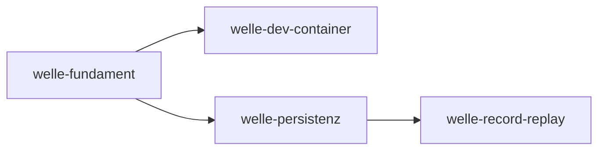

# Roadmap

**Format-Regel:** Die Roadmap ist eine Reihenfolge von **Wellen**,
keine Reihenfolge von Terminen (siehe
Baseline-Regelwerk `modul-06-roadmap.md`).
Termine werden — falls überhaupt — als Konsequenz der Wellen-Schätzung
gezeigt, nicht als Treiber.

---

## Offene Wellen

Regeln dieser Sektion: Baseline-Regelwerk `modul-06-roadmap.md`
§Roadmap-Struktur: fünf Abschnitte — *Offene Wellen* ist **derivativ**: Der
Zustand sind die flachen Welle-Dateien; woran gearbeitet wird, sagt das
`Welle:`-Feld der Slices in `in-progress/`. Ziel, Trigger und
Closure-Kriterien stehen in der Welle-Datei, nicht hier.

- [welle-record-replay](../welle-record-replay.md)

## Nächste Wellen

Regeln dieser Sektion: Baseline-Regelwerk `modul-06-roadmap.md`
§Roadmap-Struktur: fünf Abschnitte, Bullet *Nächste Wellen* — die geordnete
Vorschau: je Zeile Welle, Trigger als beobachtbare Bedingung, wichtigste Slices
und geschätzter Aufwand (S/M/L, kein Termin).

| Welle | Trigger | Wichtigste Slices | Geschätzter Aufwand |
|---|---|---|---|
| welle-dev-container | welle-fundament done | Gerüst des Arbeitscontainers mit `u-boot` am Host (privilegierter Container mit eigenem Docker-Daemon, SSH-Zugang, Schlüsselpaar), Start mit Bereitschaftsprobe, Bare-Repo und Klon samt Einlieferung per Zweig, Lauf von `make gates` und `make gegenproben` im Container, Dokument für Entwickler | L |

## Meilensteine

Regeln dieser Sektion: Baseline-Regelwerk `modul-06-roadmap.md`
§Welle ≠ Meilenstein ≠ Release.

| Meilenstein | Welle(n) | Trigger | Status |
|---|---|---|---|
| M1 | welle-fundament | `make gates` fährt Build, Test, Lint und `a-check` auf Go-Code, jedes durch eine Gegenprobe belegt | erreicht — [slice-gegenproben-build-test](../done/slice-gegenproben-build-test.md) |
| M2 | welle-record-replay | Ein Test zeichnet gegen einen Referenzdienst auf und spielt ohne Upstream wieder ab | offen |

## Abhängigkeitsgraph

Regeln dieser Sektion: Baseline-Regelwerk `modul-06-roadmap.md`
§Roadmap-Struktur: fünf Abschnitte, Bullet *Nächste Wellen* — die Abhängigkeit
steht als beobachtbare Bedingung in der `Trigger`-Spalte **und** als gerichtete
Kante hier; eine Welle, die ohne fertige Vorgängerin nicht starten kann, ist
eine Phantom-Welle.

## Abgeschlossene Wellen

Regeln dieser Sektion: Baseline-Regelwerk `modul-06-roadmap.md`
§Roadmap-Struktur: fünf Abschnitte.

| Welle | Abschluss | Closure-Notiz |
|---|---|---|
| welle-fundament | 2026-10-19 | [welle-fundament-results](../done/welle-fundament-results.md) |
| welle-persistenz | 2026-10-20 | [welle-persistenz-results](../done/welle-persistenz-results.md) |

## Historische Trigger-Verschiebungen

Regeln dieser Sektion: Baseline-Regelwerk `modul-06-roadmap.md`
§Roadmap-Struktur: fünf Abschnitte, Bullet *Historische Trigger-Verschiebungen*
— das Drift-Log: jede Umplanung mit Datum, Änderung, Grund. Leer heißt starre
Roadmap, jede Zeile voll heißt treibende.

| Datum | Was wurde geändert? | Warum? |
|---|---|---|
| 2026-10-21 | [welle-record-replay](../welle-record-replay.md): [slice-record-service](../done/slice-record-service.md) vor dem ersten Code-Commit geschnitten; der Adapter `httpupstream` ist [slice-upstream-adapter](../in-progress/slice-upstream-adapter.md), nach `slice-record-service` und vor `slice-bootstrap-m2`; die Welle führt 15 Slices statt 14 | Schätzung rund 4700 Zeilen und drei Schichten (Outbound Port, Dienst, Driven Adapter) in einem Slice; ein Schnitt vor dem Code statt einer Rückführung danach, die bei zehn Überschreitungen keinmal genommen wurde (`BEO-REPO/groessenmarke-ueberschritten-ohne-rueckfuehrung`) |
| 2026-10-21 | [welle-record-replay](../welle-record-replay.md): [slice-upstream-adapter](../in-progress/slice-upstream-adapter.md) beim Handoff geschnitten; die TLS-Konfiguration des Adapters (`CAPEM`, `Pruefen`, HTTP/1.1 über TLS) ist [slice-upstream-tls](../open/slice-upstream-tls.md), nach `slice-upstream-adapter` und vor `slice-bootstrap-m2`; die Welle führt 16 Slices statt 15 | Handoff 2831 Zeilen über der Schwelle 2500 aus §4 des Plans; ohne Schnitt hielte die Marke 2900 nur bei höchstens 69 Zeilen Zuwachs im Review, gemessen waren in den Vorgängern 12,3 und 16,1 %; der Schnitt war vorab benannt und durch die Auflage (TLS-Teil zuletzt, in eigenem Commit) nach dem Code nehmbar |
| 2026-10-21 | [welle-record-replay](../welle-record-replay.md): [slice-race-gate](../open/slice-race-gate.md) neu, vor `slice-http-adapter`, dessen Start ihn in `done/` verlangt; [slice-protokolltreue](../open/slice-protokolltreue.md) neu, nach `slice-bootstrap-m2` als letzter Slice; die Welle führt 18 Slices statt 16 | Entscheidung des Users zu den Beobachtungen über der Schwelle: `BEO-REPO/nebenlaeufiger-lauf-nur-im-glueck-gruen` (5×) bekommt den Ausgang `geplant` mit einem Race-Detektor im Gate; der Vergleichstest der Messmethode von `LH-QA-07` hatte in der Welle keinen Träger, und `slice-bootstrap-m2` bleibt beim Satz von M2 |
