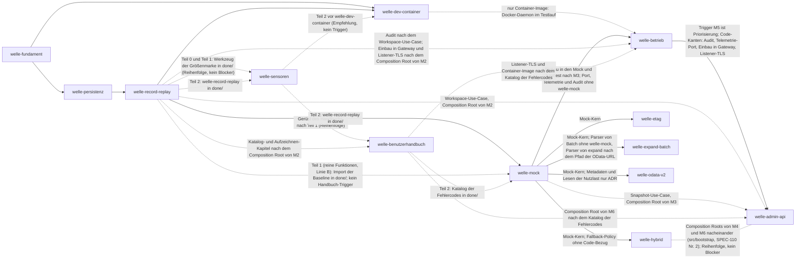

# Roadmap

**Format-Regel:** Die Roadmap ist eine Reihenfolge von **Wellen**,
keine Reihenfolge von Terminen (siehe
Baseline-Regelwerk `modul-06-roadmap.md`).
Termine werden — falls überhaupt — als Konsequenz der Wellen-Schätzung
gezeigt, nicht als Treiber.

---

## Offene Wellen

Regeln dieser Sektion: Baseline-Regelwerk `modul-06-roadmap.md`
§Roadmap-Struktur: fünf Abschnitte — *Offene Wellen* ist **derivativ**: Der
Zustand sind die flachen Welle-Dateien; woran gearbeitet wird, sagt das
`Welle:`-Feld der Slices in `in-progress/`. Ziel, Trigger und
Closure-Kriterien stehen in der Welle-Datei, nicht hier.

In Arbeit: [slice-admin-imports](../done/slice-admin-imports.md) ([welle-admin-api](../welle-admin-api.md), Teil 1 des Schnitts: `POST /__admin/imports` und `GET /__admin/imports/{id}`, Body, Antworten, Fehlerabbildung und Import-Autorisierung).

In Arbeit: [slice-admin-workspaces](slice-admin-workspaces.md) ([welle-admin-api](../welle-admin-api.md), Teil 1 des Schnitts: `WorkspaceRouten` mit acht Routen für Workspaces und Snapshots, die drei Bodys, Antworten, JSON, Fehlerabbildung und Authentisierung).

In Arbeit: [slice-telemetry-einbau-replay](slice-telemetry-einbau-replay.md) ([welle-betrieb](../welle-betrieb.md), Teil 2 des Schnitts von [slice-telemetry-einbau-gateway](../done/slice-telemetry-einbau-gateway.md): Match-Span `odata.replay.match` im Replay-Dienst und ein Adapter der Telemetrie je Prozess in `replay` und `hybrid`).

- [welle-admin-api](../welle-admin-api.md): gestartet über Ausnahmen je Slice; ihr Trigger steht unter *Nächste Wellen*.
- [welle-benutzerhandbuch](../welle-benutzerhandbuch.md): gestartet.
- [welle-betrieb](../welle-betrieb.md): Trigger eingetreten, gestartet über Ausnahmen je Slice.
- [welle-dev-container](../welle-dev-container.md): Trigger eingetreten, kein Slice gestartet.
- [welle-expand-batch](../welle-expand-batch.md): gestartet.
- [welle-odata-v2](../welle-odata-v2.md): gestartet.
- [welle-sensoren](../welle-sensoren.md): gestaffelt gestartet, die Trigger von Teil 0 bis Teil 2 sind eingetreten.

**Lesart:** Eine Welle steht hier, wenn ihr Trigger eingetreten ist oder ihr erster Slice gestartet ist; sonst steht sie unter *Nächste Wellen* mit Link auf ihre Datei. Bei einer Welle mit gestaffeltem Start (`welle-sensoren`) zählt der Trigger ihres ersten Teils. Ein einzelner Slice, der vor dem Trigger seiner Welle starten darf, weil kein Code der Vorgänger-Welle fehlt, ist eine Ausnahme je Slice (Zusatz in §2 der Welle-Datei) und verschiebt die Welle nicht; sie steht dann hier und unter *Nächste Wellen* (`welle-admin-api`). Welche Slices einer Welle offen oder startbar sind, sagen ihre Welle-Datei (Slice-Liste) und das Verzeichnis `open/`; die Roadmap führt keinen offenen Slice.

## Nächste Wellen

Regeln dieser Sektion: Baseline-Regelwerk `modul-06-roadmap.md`
§Roadmap-Struktur: fünf Abschnitte, Bullet *Nächste Wellen* — die geordnete
Vorschau: je Zeile Welle, Trigger als beobachtbare Bedingung, wichtigste Slices
und geschätzter Aufwand (S/M/L, kein Termin).

| Welle | Trigger | Wichtigste Slices | Geschätzter Aufwand |
|---|---|---|---|
| [welle-admin-api](../welle-admin-api.md) | `welle-betrieb` liegt in `done/` (M5 erreicht; Priorisierung, keine Code-Abhängigkeit, Ausnahmen je Slice in §2 der Welle-Datei) | Admin-Listener mit Token und Transportschutz, Endpunkte für Sessions, Imports, Workspaces und Snapshots, Sicherheitsnachweis, Composition Root mit M6-Test | L |

## Meilensteine

Regeln dieser Sektion: Baseline-Regelwerk `modul-06-roadmap.md`
§Welle ≠ Meilenstein ≠ Release.

| Meilenstein | Welle(n) | Trigger | Status |
|---|---|---|---|
| M1 | welle-fundament | `make gates` fährt Build, Test, Lint und `a-check` auf Go-Code, jedes durch eine Gegenprobe belegt | erreicht — [slice-gegenproben-build-test](../done/altbestand/slice-gegenproben-build-test.md) |
| M2 | welle-record-replay | Ein Test zeichnet gegen einen Referenzdienst auf und spielt ohne Upstream wieder ab | erreicht — `TestDurchstichM2` (`tests/integration/m2_test.go`, Teil von `make test`) |
| M3 | welle-mock | Ein Test beantwortet aus einer importierten Baseline `$metadata` und Abfragen mit Optionen, ändert und löscht Entities mit sichtbaren Zustandsübergängen, stellt einen Snapshot wieder her und setzt zurück, ohne Upstream | erreicht — `TestM3` (`tests/integration/m3_test.go`, Teil von `make test`) |
| M4 | welle-hybrid | Ein Test belegt am Verbindungszähler eines Referenzdienstes, dass im Modus `hybrid` nur freigegebene lesende Anfragen den Upstream erreichen und ein POST ohne Freigabe nie | erreicht — `TestM4` (`tests/integration/m4_test.go`, Teil von `make test`) |
| M5 | welle-betrieb | Der Lasttest nach `LH-QA-01.a` läuft reproduzierbar und weist p95 aus dem Gesamtspan für Replay und Mock aus | offen |
| M6 | welle-admin-api | Ein Test steuert Aufzeichnung, Import, Workspace, Snapshot und Reset ausschließlich über den Admin-Listener mit Token und weist Anfragen ohne Token ab | offen; Bedingung: Entscheidung des Users zur Begrenzung der Fehlversuche und zum Umfang der Audit-Einträge des Abweisens ([welle-admin-api](../welle-admin-api.md) §5) |
| M7 | welle-record-replay, welle-mock, welle-hybrid, welle-betrieb, welle-admin-api, welle-dev-container | Erstabnahme: alle Muss-Anforderungen des Lastenhefts haben einen Beleg, der fachliche Owner hat den Zielwert von `LH-QA-01` bestätigt, und das Lastenheft trägt den Status `Accepted` | offen; Bedingung: Bestätigung des Zielwerts von `LH-QA-01` durch den Owner ([welle-betrieb](../welle-betrieb.md) §3) |

## Abhängigkeitsgraph

Regeln dieser Sektion: Baseline-Regelwerk `modul-06-roadmap.md`
§Roadmap-Struktur: fünf Abschnitte, Bullet *Nächste Wellen* — die Abhängigkeit
steht als beobachtbare Bedingung in der `Trigger`-Spalte **und** als gerichtete
Kante hier; eine Welle, die ohne fertige Vorgängerin nicht starten kann, ist
eine Phantom-Welle.

## Abgeschlossene Wellen

Regeln dieser Sektion: Baseline-Regelwerk `modul-06-roadmap.md`
§Roadmap-Struktur: fünf Abschnitte.

| Welle | Abschluss | Closure-Notiz |
|---|---|---|
| welle-fundament | 2026-10-19 | [welle-fundament-results](../done/welle-fundament-results.md) |
| welle-persistenz | 2026-10-20 | [welle-persistenz-results](../done/welle-persistenz-results.md) |
| welle-record-replay | 2026-11-06 | [welle-record-replay-results](../done/welle-record-replay-results.md) |
| welle-mock | 2026-11-08 | [welle-mock-results](../done/welle-mock-results.md) |
| welle-etag | 2026-11-18 | [welle-etag-results](../done/welle-etag-results.md) |
| welle-hybrid | 2026-11-19 | [welle-hybrid-results](../done/welle-hybrid-results.md) |

## Historische Trigger-Verschiebungen

Regeln dieser Sektion: Baseline-Regelwerk `modul-06-roadmap.md`
§Roadmap-Struktur: fünf Abschnitte, Bullet *Historische Trigger-Verschiebungen*
— das Drift-Log: jede Umplanung mit Datum, Änderung, Grund. Leer heißt starre
Roadmap, jede Zeile voll heißt treibende.

| Datum | Was wurde geändert? | Warum? |
|---|---|---|
| 2026-10-21 | [welle-record-replay](../done/welle-record-replay/welle-record-replay.md): [slice-record-service](../done/welle-record-replay/slice-record-service.md) vor dem ersten Code-Commit geschnitten; der Adapter `httpupstream` ist [slice-upstream-adapter](../done/welle-record-replay/slice-upstream-adapter.md), nach `slice-record-service` und vor `slice-bootstrap-m2`; die Welle führt 15 Slices statt 14 | Schätzung rund 4700 Zeilen und drei Schichten (Outbound Port, Dienst, Driven Adapter) in einem Slice; ein Schnitt vor dem Code statt einer Rückführung danach, die bei zehn Überschreitungen keinmal genommen wurde (`BEO-REPO/groessenmarke-ueberschritten-ohne-rueckfuehrung`) |
| 2026-10-21 | [welle-record-replay](../done/welle-record-replay/welle-record-replay.md): [slice-upstream-adapter](../done/welle-record-replay/slice-upstream-adapter.md) beim Handoff geschnitten; die TLS-Konfiguration des Adapters (`CAPEM`, `Pruefen`, HTTP/1.1 über TLS) ist [slice-upstream-tls](../done/welle-record-replay/slice-upstream-tls.md), nach `slice-upstream-adapter` und vor `slice-bootstrap-m2`; die Welle führt 16 Slices statt 15 | Handoff 2831 Zeilen über der Schwelle 2500 aus §4 des Plans; ohne Schnitt hielte die Marke 2900 nur bei höchstens 69 Zeilen Zuwachs im Review, gemessen waren in den Vorgängern 12,3 und 16,1 %; der Schnitt war vorab benannt und durch die Auflage (TLS-Teil zuletzt, in eigenem Commit) nach dem Code nehmbar |
| 2026-10-21 | [welle-record-replay](../done/welle-record-replay/welle-record-replay.md): [slice-race-gate](../done/welle-record-replay/slice-race-gate.md) neu, vor `slice-http-adapter`, dessen Start ihn in `done/` verlangt; [slice-protokolltreue](../done/welle-record-replay/slice-protokolltreue.md) neu, nach `slice-bootstrap-m2` als letzter Slice; die Welle führt 18 Slices statt 16 | Entscheidung des Users zu den Beobachtungen über der Schwelle: `BEO-REPO/nebenlaeufiger-lauf-nur-im-glueck-gruen` (5×) bekommt den Ausgang `geplant` mit einem Race-Detektor im Gate; der Vergleichstest der Messmethode von `LH-QA-07` hatte in der Welle keinen Träger, und `slice-bootstrap-m2` bleibt beim Satz von M2 |
| 2026-10-23 | [welle-record-replay](../done/welle-record-replay/welle-record-replay.md): [slice-session-wartung](../done/welle-record-replay/slice-session-wartung.md) beim Start vor dem ersten Code-Commit geschnitten; `SessionUseCase` ist [slice-session-use-case](../done/welle-record-replay/slice-session-use-case.md), nach `slice-session-wartung` (`MaintenanceUseCase`) und vor `slice-baseline-import` und `slice-bootstrap-m2`; die Welle führt 19 Slices statt 18 | Schätzung beider Use Cases in einem Slice rund 3250 bis 3750 Zeilen (Tabelle × 85 bzw. 40, plus Port-Fakes, × 1,25), über der Grenze 3000 aus `AGENTS.md` §3.14; ein Schnitt vor dem Code statt einer Rückführung danach (`BEO-REPO/groessenmarke-ueberschritten-ohne-rueckfuehrung`); gemeinsam ist nur der Port der Bereinigung |
| 2026-10-23 | [welle-record-replay](../done/welle-record-replay/welle-record-replay.md): [slice-session-use-case](../done/welle-record-replay/slice-session-use-case.md) beim Start vor dem ersten Code-Commit geschnitten; das Beenden (`Drain`, Statusregel, `CloseAll`) ist [slice-session-beenden](../done/welle-record-replay/slice-session-beenden.md), nach `slice-session-use-case` und vor `slice-bootstrap-m2`; die Welle führt 20 Slices statt 19 | Schätzung beider Teile in einem Slice rund 3300 Zeilen (30 Zeilen der Tabelle, 9 nebenläufig, 5 Port-Fakes, × 1,25), über der Grenze 3000 aus `AGENTS.md` §3.14; ein Schnitt vor dem Code statt einer Rückführung danach; gemeinsam sind Konstruktor, Konfig, Fehlerabbildung und die Fakes des Pakets |
| 2026-10-25 | [welle-record-replay](../done/welle-record-replay/welle-record-replay.md): [slice-groessenmarke-werkzeug](../done/welle-record-replay/slice-groessenmarke-werkzeug.md) neu, nach `slice-baseline-import` und vor `slice-workspace-use-case`; die Welle führt 21 Slices statt 20 | Entscheidung des Users zu `BEO-REPO/groessenmarke-ueberschritten-ohne-rueckfuehrung` (16×): Ausgang `geplant` mit einem Werkzeug statt einer Prosa-Regel, denn die Formel der Platte verfehlt zwei von drei Messpunkten; das Werkzeug soll vor der nächsten Marke (`slice-workspace-use-case`) liegen; die Einordnung in die Welle ist vom User bestätigt |
| 2026-10-30 | Reihenfolge der Wellen: [welle-sensoren](../welle-sensoren.md) startet gestaffelt, Teil 1 (`slice-unsichtbare-zeichen`, `slice-guide-groessen-gate`) nach `slice-groessenmarke-werkzeug` und vor `slice-workspace-use-case` (Reihenfolge, kein Blocker), Teil 2 (`slice-abdeckung-deklaration`, `slice-coverage-gate`) nach `welle-record-replay`; [welle-dev-container](../welle-dev-container.md) startet nach `welle-record-replay` (Trigger vorher nur `welle-fundament`), Kante zu `slice-container-image` von [welle-betrieb](../welle-betrieb.md); `slice-handbuch-geruest` nach Teil 1; `slice-cli-kommandos` entfällt, [welle-admin-api](../welle-admin-api.md) führt 8 Slices statt 9 | Teil 1 schützt jede Datei, die die folgenden Slices schreiben, und friert die Größe der Guide-Dateien ein, ohne `src/` zu berühren; Teil 2 (Backfill über 618 Testfunktionen in 105 Dateien, Schwelle gegen den Code von M2) kollidiert mit den Dateien, die die Slices von M2 schreiben; der Arbeitscontainer fährt eine Gate-Kette, die nach M2 stabil ist, und der Neustarttest von `slice-container-image` braucht dessen Docker-Daemon; kein Anker im Lastenheft für Kommandos über Start und Version hinaus (`LH-FA-13` verlangt eine Verwaltungsschnittstelle). Entscheidungen des Users zum Abgleich [Lastenheft gegen Wellen](../../../reviews/2026-10-30-lastenheft-wellen-abgleich.md) |
| 2026-10-30 | [welle-mock](../done/welle-mock/welle-mock.md) startet gestaffelt: Teil 1 (`slice-odata-url-pfad`, `slice-odata-url-filter`, `slice-edm-ausdruecke`, `slice-query-interpreter`, `slice-odata-json-schreiben`, `slice-odata-json-eingabe`) mit dem Trigger `slice-baseline-import` in `done/` (erfüllt), die Welle steht unter *Offene Wellen*; Teil 2 (`slice-mock-lesen`, `slice-mock-schreiben`, `slice-snapshot-use-case`, `slice-mock-abnahme`, `slice-bootstrap-m3`) behält den Trigger (`welle-record-replay` und `slice-handbuch-meldungskatalog` in `done/`); Parallelbetrieb produktiver Slices in Worktrees mit [Übergangsregeln](../README.md#parallelbetrieb-in-worktrees-übergangsregeln) (Sperre für schwere Läufe, Stempel im Integrationsschritt, Kennungsbereiche je Linie); `slice-worktree-parallel` neu als Teil 0 von [welle-sensoren](../welle-sensoren.md), nicht-produktiv, blockiert nichts; die Welle führt 5 Slices statt 4 | Entscheidung des Users: produktive Slices und Wellen sollen jetzt parallel in Worktrees laufen, der Werkzeug-Slice darf sie nicht blockieren. Die sechs Slices von Teil 1 sind reine Funktionen und Codecs auf Modell und Codec zum Lesen, ohne Port-Anbindung und ohne sichtbares Verhalten am Binary; sie brauchen weder `welle-record-replay` noch das Handbuch-Gerüst. Die Antwort des Users auf Frage 7 des Abgleichs („frühestens nach `welle-dev-container`“) ist damit durch die Übergangsregeln ersetzt |
| 2026-10-30 | Start-Trigger je Slice statt je Welle: die Slice-Pläne von [welle-hybrid](../done/welle-hybrid/welle-hybrid.md), [welle-betrieb](../welle-betrieb.md), [welle-admin-api](../welle-admin-api.md), [welle-etag](../done/welle-etag.md), [welle-expand-batch](../welle-expand-batch.md) und [welle-odata-v2](../welle-odata-v2.md) liegen in `open/` und tragen ihre Abhängigkeiten; Wellen-Trigger bleiben formal, Ausnahmen je Slice stehen in den Welle-Dateien (§2). Gestartet vor dem Welle-Trigger: `slice-telemetry-port` (Linie D, Kennungsbereich in den [Übergangsregeln](../README.md#parallelbetrieb-in-worktrees-übergangsregeln)); `slice-handbuch-geruest` vor Teil 1 von [welle-sensoren](../welle-sensoren.md) und vor `slice-groessenmarke-werkzeug` in `done/`, [welle-benutzerhandbuch](../welle-benutzerhandbuch.md) steht damit unter *Offene Wellen*; `slice-workspace-use-case` (Linie A) vor der Closure des Werkzeug-Slice. `welle-betrieb` bleibt unter *Nächste Wellen* | Entscheidung des Users: Slice-Pläne aller Produkt-Wellen jetzt anlegen, Abhängigkeiten in den Plänen führen und freie Linien in eigenen Worktrees starten. Die Pläne zeigen Slices ohne Code-Bezug zum Trigger ihrer Welle (`slice-telemetry-port`, `slice-audit-log`, `slice-batch-parser`, `slice-v2-metadaten`, `slice-fallback-policy`); der Start von `slice-telemetry-port` ist eine Ausnahme je Slice und nicht der Start der Welle, deren Closure (Spans von Mock und Workspace, Lasttest) `welle-mock` voraussetzt |
| 2026-10-31 | [welle-record-replay](../done/welle-record-replay/welle-record-replay.md): [slice-http-lebenszyklus](../done/welle-record-replay/slice-http-lebenszyklus.md) neu, aus [slice-http-adapter](../done/welle-record-replay/slice-http-adapter.md) vor dem Code geschnitten, nach dem Kern und vor `slice-bootstrap-m2`; [slice-cli-adapter](../done/welle-record-replay/slice-cli-adapter.md) neu (`ARC-006`), vor `slice-bootstrap-m2`; [slice-test-integration](../done/welle-record-replay/slice-test-integration.md) (`SPEC-037`) und [slice-test-determinism](../done/welle-record-replay/slice-test-determinism.md) (`SPEC-038`) neu, nach `slice-bootstrap-m2`; die Welle führt 25 Slices statt 21. [welle-mock](../done/welle-mock/welle-mock.md): [slice-test-contract](../done/welle-mock/slice-test-contract.md) (`SPEC-042`) neu, nach `slice-bootstrap-m3`; `slice-bootstrap-m3`, `-m4` und `-m6` führen je ein Szenario von `make test-integration` in der DoD. Rückverfolgungs-Matrix [rueckverfolgung](../rueckverfolgung.md) neu | Schätzung des Architect zu `slice-http-adapter`: 3525 Zeilen, Marke 4800, über der Grenze 3000 aus `AGENTS.md` §3.14; der Lebenszyklus ist der einzige Teil ohne geteilten Mechanismus mit dem Kern. `ARC-006` (CLI) und die Verträge `SPEC-037`, `SPEC-038`, `SPEC-042` hatten keinen Träger in einem Plan; kein Test fuhr das gebaute Binary, obwohl `LH-RB-03.a` einen End-to-End-Test als Nachweis nennt. Entscheidung des Users: das lauffähige Produkt (Durchstich M2) hat Vorrang, die Absicherung folgt danach |
| 2026-11-01 | [welle-record-replay](../done/welle-record-replay/welle-record-replay.md): [slice-m2-referenzdienst](../done/welle-record-replay/slice-m2-referenzdienst.md) neu, aus `slice-bootstrap-m2` vor dem ersten Code-Commit geschnitten, nach ihm und vor [slice-protokolltreue](../done/welle-record-replay/slice-protokolltreue.md); `slice-bootstrap-m2` liefert den Root-Kern, der Referenzdienst, die Verdrahtung von Import und Workspace und der M2-Test wandern; die Welle führt 26 Slices statt 25; die Zelle M2 bleibt offen bis zur Closure der Welle | Schätzung des Architect: beide Hälften zusammen S rund 3200 (Marke 4400, Schnittfrage ab 2223 nach `SPEC-128`), der Kern allein S = 2120 (Marke 2900); der Schnitt teilt keinen Mechanismus, denn Referenzdienst, Import und Workspace sind additive Zugänge am `Handle`. Nehmer nachgezogen (`AGENTS.md` §3.13): `slice-protokolltreue`, `slice-test-integration`, `slice-test-determinism`, `slice-handbuch-record-replay`, `slice-bootstrap-m3`, `-m4`, `-m6`, `slice-abdeckung-deklaration`, `slice-test-security` |
| 2026-11-01 | [welle-record-replay](../done/welle-record-replay/welle-record-replay.md): [slice-text-antworten](../done/welle-record-replay/slice-text-antworten.md) neu, nach [slice-m2-referenzdienst](../done/welle-record-replay/slice-m2-referenzdienst.md) und vor [slice-protokolltreue](../done/welle-record-replay/slice-protokolltreue.md); die Welle führt 27 Slices statt 26 | Befund des Reviews zu `slice-m2-referenzdienst`: `text/*` war nicht aufzeichenbar (`SPEC-118` Nr. 3), obwohl `/$count` als `text/plain` beschrieben ist. Entscheidung des Owners: `text/*` ist bekannt bei `/$count` und `/<Property>/$value`, sonst unbekannt (Wortlaut `SPEC-118` Nr. 11, vor dem Code in der Spezifikation, keine ADR, Lastenheft unberührt). Der Slice ändert Produktcode (Redaktor, Record-Dienst) und den Referenzdienst, `slice-protokolltreue` nur einen Test; der Durchstich M2 bleibt bei JSON-`$count`. Nehmer nachgezogen (`AGENTS.md` §3.13): `slice-protokolltreue`; der Geber `slice-m2-referenzdienst` trägt die Sendung im Zweig |
| 2026-11-01 | [welle-odata-v2](../welle-odata-v2.md): nach [ADR-0011](../../adr/0011-versionierter-adapter-fuer-odata-v2.md) neu `slice-v2-import-codecs` (vor `slice-v2-bootstrap`), `slice-v2-payload` geschnitten in `slice-v2-payload-lesen` und `slice-v2-payload-schreiben`; die Kette metadaten, payload, query, bootstrap entfällt, vier Slices starten ohne `welle-mock`; die Welle führt 6 Slices statt 4 | Der Architect entschied den Import je Version (derselbe Importer, Satz je Dienst) und schnitt die Nutzlast an der Tabelle der Typen, die nur die Spezifikation teilt; der Parser kennt das Modell nicht, das Modell ist derselbe Typ. Nehmer nachgezogen (`AGENTS.md` §3.13): `slice-mock-lesen`, `slice-odata-json-schreiben`, `slice-bootstrap-m3` |
| 2026-11-01 | [welle-odata-v2](../welle-odata-v2.md): `slice-v2-query` geschnitten in `slice-v2-query` (Pfad, Optionen, Kompatibilitätsfehler, Einhängestelle `WithFilter`) und neu [slice-v2-query-filter](../done/slice-v2-query-filter.md) (Leser von `$filter`), Reihenfolge `slice-v2-query`, `slice-v2-query-filter`, `slice-v2-bootstrap`; die Welle führt 7 Slices statt 6 | Der Architect schnitt vor dem Code (Schätzung ungeschnitten 8500, Schwelle 2223 nach `SPEC-128`): die Grammatik von `$filter` teilt mit dem Rest allein die Literal-Funktion und die Einhängestelle. Nehmer nachgezogen (`AGENTS.md` §3.13): `slice-v2-bootstrap` |
| 2026-11-06 | Linie C (Gate-Kette): [slice-gate-integration-determinism](../done/slice-gate-integration-determinism.md) und [slice-guard-schreibwege](../done/slice-guard-schreibwege.md) neu, beide ohne Welle, nach der Closure von `welle-record-replay` und nicht zugleich mit einem anderen Slice der Kette (Nr. 7 der [Übergangsregeln](../README.md#parallelbetrieb-in-worktrees-übergangsregeln)); die Reihenfolge zu den Slices von Teil 2 von [welle-sensoren](../welle-sensoren.md) legt der Start fest | Entscheidung des Users zur Closure: `make test-integration` und `make test-determinism` kommen in `GATE_CHECKS` (Register `BEO-REPO/pflichtlauf-neben-der-gate-kette-ohne-traeger`), und die Betriebsregel „Repo-Dateien nur mit `Edit` und `Write`“ bekommt einen Wächter im Command-Guard (`BEO-REPO/betriebsregel-fuer-repo-dateien-verletzt`, 4×) |
| 2026-11-06 | [welle-betrieb](../welle-betrieb.md): `slice-audit-log` ist vor dem Code in drei Slices geschnitten, zwei neue Pläne in [open/](../done/slice-audit-dienste.md) (`slice-audit-dienste`, [slice-audit-verdrahtung](../done/slice-audit-verdrahtung.md)); die Start-Bedingung von `slice-admin-sessions`, `slice-admin-workspaces` und `slice-admin-imports` nennt zusätzlich `slice-audit-dienste` | Schätzung der ungeschnittenen Tabelle 4815 liegt über der Schwelle der Schnittfrage (`SPEC-128` Nr. 1); die Einträge der Löschungen entstehen erst in den Diensten, und die Admin-Slices dürfen sie nicht doppeln |
| 2026-11-06 | [welle-betrieb](../welle-betrieb.md): [slice-audit-verdrahtung](../done/slice-audit-verdrahtung.md) auf die Fänger der Datei im Betrieb verkleinert (Marke 500 statt 600), die Verdrahtung im Composition Root liegt als Brücke in [slice-audit-dienste](../done/slice-audit-dienste.md) | ohne die Übergabe von `Audit` scheitert `Build` (`SPEC-234` Nr. 8), zwischen den beiden Slices bestünde kein grüner Stand |
| 2026-11-07 | [welle-betrieb](../welle-betrieb.md): [slice-telemetry-log](../done/slice-telemetry-log.md) ist vor dem Code in zwei Teile geschnitten, neu [slice-telemetry-handler](../done/slice-telemetry-handler.md) (`Handler()`, Arten, `WithAttrs`, `WithGroup`, Abbildung der Dienste) nach `slice-telemetry-log` (Zeile, Stufen, Senke, Sperre); die Welle führt einen Slice mehr; die Start-Bedingung von `slice-telemetry-einbau-gateway` und `slice-telemetry-einbau-mock` nennt zusätzlich `slice-telemetry-log`, `slice-telemetry-handler` und `slice-telemetry-spans`, `slice-telemetry-spans` hängt nur an `slice-telemetry-log` | Schätzung des ungeschnittenen Plans 3095 liegt über der Schwelle der Schnittfrage 2223 (`SPEC-128` Nr. 1); die Teile teilen keinen Mechanismus, den der zweite neu schriebe (Schätzung 2085 und 1010). Nehmer nachgezogen (`AGENTS.md` §3.13): `slice-telemetry-spans`, `slice-telemetry-einbau-gateway`, `slice-telemetry-einbau-mock`, `slice-mock-lesen` (Orakel-Liste der Codes) |
| 2026-11-07 | [welle-mock](../done/welle-mock/welle-mock.md): `slice-mock-lesen` ist vor dem Code in zwei Teile geschnitten, neu [slice-mock-zuordnung](../done/welle-mock/slice-mock-zuordnung.md) (Port, Konfig, Zuordnung, `$metadata`) vor [slice-mock-lesen](../done/welle-mock/slice-mock-lesen.md) (Collection, Lookup, Anzahl, Coverage); die Welle führt einen Slice mehr; die Start-Bedingung von `slice-mock-schreiben` und `slice-hybrid-service` nennt zusätzlich `slice-mock-zuordnung` | Schätzung des ungeschnittenen Plans 8715 liegt über der Schwelle der Schnittfrage (`SPEC-128` Nr. 1); die Teile teilen keinen Mechanismus, den der zweite neu schriebe. Nehmer nachgezogen (`AGENTS.md` §3.13): `slice-mock-schreiben`, `slice-hybrid-service`, `slice-bootstrap-m3` |
| 2026-11-07 | [welle-admin-api](../welle-admin-api.md): [slice-inspection-use-case](../done/slice-inspection-use-case.md) ist vor dem Code in zwei Teile geschnitten, neu [slice-inspection-coverage-diagnose](../done/slice-inspection-coverage-diagnose.md) (Coverage, Diagnose) nach `slice-inspection-use-case` (Exchanges); die Welle führt einen Slice mehr; die Start-Bedingung von `slice-admin-sessions` und `slice-bootstrap-m6` nennt zusätzlich `slice-inspection-coverage-diagnose`, die von `slice-admin-listener-token` zusätzlich `slice-telemetry-port` | Schätzung des ungeschnittenen Plans 3840 liegt über der Schnittgrenze (*S* ≥ 2223, `SPEC-128` Nr. 1); die Teile teilen nur das Gerüst (Paket, `Konfig`, `New`, etwa 30 Zeilen). Nehmer nachgezogen (`AGENTS.md` §3.13): `slice-admin-sessions`, `slice-admin-listener-token`, `slice-bootstrap-m6` |
| 2026-11-07 | [welle-admin-api](../welle-admin-api.md): [slice-admin-listener-token](../done/slice-admin-listener-token.md) ist vor dem Code in sechs Teile geschnitten, fünf neue Pläne in `open/` nach dem Teil 1 (Token-Datei, bleibt dieser Slice): [slice-admin-rahmen](../done/slice-admin-rahmen.md), [slice-admin-authentisierung](../done/slice-admin-authentisierung.md), [slice-admin-lebenszyklus](../done/slice-admin-lebenszyklus.md), [slice-admin-fehlerabbildung](../done/slice-admin-fehlerabbildung.md), [slice-admin-abweisen-audit](../done/slice-admin-abweisen-audit.md); die Welle führt fünf Slices mehr; die Start-Bedingung von `slice-admin-sessions`, `slice-admin-imports`, `slice-admin-workspaces`, `slice-admin-tls`, `slice-test-security` und `slice-bootstrap-m6` nennt zusätzlich die fünf Teile | Schätzung des ungeschnittenen Plans 9590 liegt weit über der Schnittgrenze (*S* ≥ 2223, `SPEC-128` Nr. 1); die Teile liegen bei *S* 1095 bis 2080. Gegenüber dem Vorschlag des Architect sind die Zeilen A2 und K5 (brauchen `Anhalten`), E1 und E5 (brauchen die Abbildung der Routen), H1 (braucht Audit und `Serve`) und N1 (braucht `Append`) in den Teil verschoben, dessen Code sie voraussetzt. Nehmer nachgezogen (`AGENTS.md` §3.13): `slice-admin-sessions`, `slice-admin-imports`, `slice-admin-workspaces`, `slice-admin-tls`, `slice-test-security`, `slice-bootstrap-m6` |
| 2026-11-08 | [welle-mock](../done/welle-mock/welle-mock.md): `slice-bootstrap-m3` ist vor dem Code in zwei Teile geschnitten, neu [slice-bootstrap-m3-e2e-mock](../done/welle-mock/slice-bootstrap-m3-e2e-mock.md) (Stufen `TestE2EMock` und `TestE2EMockNeustart` am gebauten Binary, Befehl `reset`) nach `slice-bootstrap-m3`; die Welle führt einen Slice mehr; `slice-bootstrap-m3` behält Verdrahtung, M3-Test und Handbuch | Schätzung des ungeschnittenen Plans 2510 liegt über der Schwelle der Schnittfrage (`SPEC-128` Nr. 1); Teil A 1745 (Marke 2400), Teil E 765 (Marke 1100); E fährt das gebaute Binary von außen und teilt keinen Mechanismus mit A. Nehmer vor dem Geber eingetragen (`AGENTS.md` §3.13) |
| 2026-11-08 | [welle-mock](../done/welle-mock/welle-mock.md): neu `slice-handbuch-mock` (Kapitel zum Modus `mock`, Zeilen `STRICT_COVERAGE` und `PUBLIC_BASE_URL`, Erweiterung von `SPEC-200`) nach `slice-bootstrap-m3`; die Welle führt einen Slice mehr; Linie C, Kettenslice (Nr. 7 der Übergangsregeln) | Der Architect von `slice-bootstrap-m3` gab Kapitel und Beispiel ab, weil `SPEC-200` Nr. 6 d und 7 b keine Umgebung kennen und die Erweiterung `pruefung handbuch` ändert; der Closure-Trigger von `welle-mock` (§3: das Handbuch deckt den Modus `mock` und seine Schlüssel ab) verlangt den Slice. Nehmer vor dem Geber eingetragen (`AGENTS.md` §3.13) |
| 2026-11-08 | Linie C (Gate-Kette): [slice-gate-integration-determinism](../done/slice-gate-integration-determinism.md) von `in-progress/` nach `open/` zurückgestellt (Rückführung ohne Code, Start-Commit `43d67170`); [slice-test-contract](../done/welle-mock/slice-test-contract.md) hält danach Nr. 7 der Übergangsregeln, `slice-handbuch-mock` folgt | User-Vorrang: `welle-mock` zuerst schließen; die Welle braucht `make test-contract` und das Handbuch, nicht die Aufnahme von `test-integration` und `test-determinism` in die Kette |
| 2026-11-08 | `slice-handbuch-mock` von [welle-mock](../done/welle-mock/welle-mock.md) nach [welle-benutzerhandbuch](../welle-benutzerhandbuch.md) verlegt; `welle-mock` schließt ohne ihn, ihr Handbuch-Kriterium beschränkt sich auf Fehlercodes und Einstellungen-Zeilen aus `slice-bootstrap-m3` | Entscheidung des Users: Kapitel und Beispiel zum Modus `mock` hängen an der Gate-Kette und blockierten die Closure von `welle-mock`. Nehmer vor dem Geber eingetragen (`AGENTS.md` §3.13); `slice-handbuch-abnahme` liegt in der Reihenfolge danach |
| 2026-11-08 | Linie C (Gate-Kette): Reihenfolge der Kettenslices [slice-gate-integration-determinism](../done/slice-gate-integration-determinism.md) (jetzt mit `make test-contract` in `GATE_CHECKS`), [slice-guard-schreibwege](../done/slice-guard-schreibwege.md) (jetzt mit `git apply`, `pgrep -f`/`kill`/`rm -rf` und Scratchpad-Namen), neu [slice-regeln-verkoerpern](../done/slice-regeln-verkoerpern.md) und [slice-groessenformel-neu](../done/slice-groessenformel-neu.md); `slice-handbuch-mock` und die weiteren Kettenslices von [welle-benutzerhandbuch](../welle-benutzerhandbuch.md) bleiben bis zur Entscheidung des Users hinter ihnen; alle vier in `open/`, kein Worktree gestartet (drei Plätze belegt) | Entscheidung des Users zu den offenen Punkten der Closure von `welle-mock` („bitte lösen“): neue Gates sind erlaubt (`AGENTS.md` §3.6), die Schreibwege des Guards sind erweitert, die Vorlagen und die Pflicht aus `SPEC-201` Nr. 11 bekommen einen Träger mit Kürzung statt Anhebung der Größengrenzen, die Faktoren der Größenformel ändern sich nach dem Vorschlag des Architect; das Zeitbudget der Gegenproben entscheidet [ADR-0013](../../adr/0013-zeitbudget-der-gegenproben-als-soll-mit-messvorschrift.md) (Proposed), der Slice dazu liegt beim User. Nehmer vor dem Geber eingetragen (`AGENTS.md` §3.13) |
| 2026-11-08 | [welle-hybrid](../done/welle-hybrid/welle-hybrid.md): `slice-fallback-policy` ist vor dem Code in zwei Teile geschnitten, neu [slice-fallback-policy-entscheidung](../done/welle-hybrid/slice-fallback-policy-entscheidung.md) (Entscheidung, Vergleich von Host und Muster, Matrix) nach [slice-fallback-policy](../done/welle-hybrid/slice-fallback-policy.md) (Prüfung der Einträge, `New`, `*KonfigFehler`); die Welle führt einen Slice mehr; die Start-Bedingung von `slice-hybrid-service` nennt zusätzlich den zweiten Teil | Schätzung des ungeschnittenen Plans 2420 (`SPEC-128` Nr. 1, Marke 3300) liegt über der Schwelle der Schnittfrage (2223); der zweite Teil baut auf der geparsten Form des ersten und schreibt keinen zweiten Parser. Schätzung und Marke: 1020 und 1400 für den ersten, 1480 und 2000 für den zweiten Teil. Nehmer nachgezogen (`AGENTS.md` §3.13): `slice-hybrid-service`, `slice-bootstrap-m4` |
| 2026-11-08 | `slice-handbuch-mock` übernimmt zusätzlich das gebundene Beispiel zu `ETAG_ENABLED` (Start mit `ETAG_ENABLED=true`, Lesen, Ändern, neuer ETag; Geber `slice-etag-versionen`) und braucht dessen Closure; ob Anfragen im Beispiel-Format in den Slice gehören, entscheidet der Architect vor dem Code | Der Architect von `slice-etag-versionen` strich das Beispiel, weil `SPEC-200` Nr. 6 d keine Umgebung kennt; dieselbe Voraussetzung wie bei `STRICT_COVERAGE` und `PUBLIC_BASE_URL`. Nehmer vor dem Geber eingetragen (`AGENTS.md` §3.13); kein Ausschluss trifft die Sendung, offen bleibt die Grenze „Anfragen an den Listener“ |
| 2026-11-08 | Linie C (Gate-Kette): neu [slice-gegenproben-zeitbudget](../done/welle-hybrid/slice-gegenproben-zeitbudget.md), ohne Welle, **fünfter der Kette** nach `slice-gate-integration-determinism`, `slice-guard-schreibwege`, `slice-regeln-verkoerpern` und `slice-groessenformel-neu` (die Lage zu den zwei letzten legt der Start fest, nie zugleich, Nr. 7 der [Übergangsregeln](../README.md#parallelbetrieb-in-worktrees-übergangsregeln)); `slice-handbuch-mock` und die weiteren Kettenslices von [welle-benutzerhandbuch](../welle-benutzerhandbuch.md) bleiben hinter ihm | Entscheidung des Users: [ADR-0013](../../adr/0013-zeitbudget-der-gegenproben-als-soll-mit-messvorschrift.md) `Accepted` (Option B); der Slice trägt die Messvorschrift in `SPEC-102` und berührt `tools/gegenproben/` und den Stempel. Nehmer vor dem Geber eingetragen (`AGENTS.md` §3.13) |
| 2026-11-08 | [welle-hybrid](../done/welle-hybrid/welle-hybrid.md): `slice-hybrid-service` ist vor dem Code in zwei Teile geschnitten, neu [slice-hybrid-service-upstream](../done/welle-hybrid/slice-hybrid-service-upstream.md) (Upstream-Fallback: Feld `Upstream`, Header-Filter, Senden, Antwort, Fehlerabbildung) nach [slice-hybrid-service](../done/welle-hybrid/slice-hybrid-service.md) (Teil 1: Mock zuerst und Replay-Fallback); die Welle führt einen Slice mehr; die Start-Bedingung von `slice-bootstrap-m4` nennt zusätzlich den zweiten Teil | Schätzung des ungeschnittenen Plans 4270 (`SPEC-128` Nr. 1, Marke 5800) liegt über der Schwelle der Schnittfrage (2223); Teil 1 2820 (Marke 3900, Schnittfrage bleibt, Grund in §4 des Plans: ein weiterer Schnitt zwischen Ablauf und Pufferung ließe 2410 und 410 und teilte den Aufruf des Mock mit gepuffertem Body und die Probe), Teil 2 2010 (Marke 2800). Nehmer nachgezogen (`AGENTS.md` §3.13): `slice-bootstrap-m4` |
| 2026-11-08 | [welle-hybrid](../done/welle-hybrid/welle-hybrid.md): [slice-hybrid-service-upstream](../done/welle-hybrid/slice-hybrid-service-upstream.md) übernimmt die Dienstwahl (`SPEC-284` Nr. 4) mit dem Fänger von Z01, H5 und die Übergabe des `Ziel` von [slice-hybrid-service](../done/welle-hybrid/slice-hybrid-service.md); Tabelle 19 statt 17 Zeilen | Teil 1 hat ohne `Dienst.UpstreamURL` ein leeres `Ziel`, die Wahl wäre dort ohne beobachtbare Wirkung; der Ausschluss in §1 von Teil 2 machte den Punkt zu einer Sendung ohne Nehmer (`AGENTS.md` §3.13). Teil 2 neu gerechnet: *S* 2220, Marke 3000, Abstand 3 zur Schnittgrenze 2223 (keine Schnittfrage nach der Formel, Nachrechnung beim Start mit dem Stand von Teil 1) |
| 2026-11-18 | [welle-hybrid](../done/welle-hybrid/welle-hybrid.md): `slice-bootstrap-m4` ist vor dem Code in zwei Teile geschnitten, neu [slice-bootstrap-m4-konfig](../done/welle-hybrid/slice-bootstrap-m4-konfig.md) (Teil 1: Lesen und Prüfen der Schlüssel `HYBRID_*` und `FALLBACK_*`, Nachzug von `SPEC-110` Nr. 2 und 8) vor [slice-bootstrap-m4](../done/welle-hybrid/slice-bootstrap-m4.md) (Teil 2: Bindung von `HybridUseCase`, M4-Test, Stufe 10, Handbuch); die Welle führt einen Slice mehr; die Start-Bedingung von `slice-bootstrap-m4` nennt zusätzlich den ersten Teil | Schätzung des ungeschnittenen Plans 2370 (`SPEC-128` Nr. 1, Marke 3200) liegt über der Schwelle der Schnittfrage (2223); Teil 1 *S* 630 (Marke 900), Teil 2 *S* 1820 (Marke 2500, mit der Zeile M22 des Architect); Teil 2 ruft nur die Funktion, die Teil 1 aus den Werten die Policy bauen lässt, und schreibt `konfig*.go` nicht um (kein geteilter Mechanismus). Entscheidung des Users zum Schnitt. Sendungen den Nehmern zugewiesen (`AGENTS.md` §3.13); Teil 1 liegt allein in `in-progress/`, Teil 2 in `open/` (ein Slice der Linie B) |
| 2026-11-18 | Linie C (Gate-Kette): neu [slice-gates-ohne-worktrees](../done/slice-gates-ohne-worktrees.md), ohne Welle, in `open/`, Reihenfolge zu `slice-guard-schreibwege`, `slice-regeln-verkoerpern`, `slice-groessenformel-neu` und `slice-gegenproben-zeitbudget` beim Start (nie zugleich, Nr. 7 der [Übergangsregeln](../README.md#parallelbetrieb-in-worktrees-übergangsregeln)) | Befund aus dem Parallelbetrieb: `make a-check` im Hauptbaum meldete 1414 Befunde aus den Worktrees unter `.wt/`; ob weitere Gates dasselbe tun, ist ungeprüft, die Abhilfe braucht eine Entscheidung des Architect (ob ADR). Nehmer vor dem Geber eingetragen (`AGENTS.md` §3.13) |
| 2026-11-18 | Linie C (Gate-Kette): neu `slice-gegenproben-eichung`, ohne Welle, in `open/`, **sechster der Kette** nach `slice-gegenproben-zeitbudget`; `slice-handbuch-mock` und die weiteren Kettenslices von [welle-benutzerhandbuch](../welle-benutzerhandbuch.md) bleiben hinter den Kettenslices | Folgepflicht aus der Closure von `slice-gegenproben-zeitbudget`: kein gültiger Lauf von `time make gegenproben` in drei Prüfrunden (Last 10 bis 280), die Eichung nach `SPEC-102` Nr. 7 braucht einen Termin ohne schwere Läufe der Maschinen und hat als Geber auch `slice-gates-ohne-worktrees` (Fälle 205 bis 216, `build/ohne-trimpath`); der Geber liegt in `done/` und ist keine Adresse. Nehmer vor dem Geber eingetragen (`AGENTS.md` §3.13) |
| 2026-11-19 | [welle-expand-batch](../welle-expand-batch.md): `slice-expand-parser` ist vor dem Code geschnitten, neu `slice-expand-validator` (Validator gegen die Navigationen des Modells); die Welle führt fünf Slices statt vier, Reihenfolge `slice-expand-parser` vor `slice-expand-validator` vor `slice-expand-ausfuehrung`; der Closure-Trigger der Welle bleibt unverändert | Schnittfrage nach `SPEC-128` Nr. 1: ungeschnitten *S* rund 3700, der Parser allein 2555; der Validator teilt mit dem Parser nur den Knoten (Plan [slice-expand-parser](../done/slice-expand-parser.md) §4) |
| 2026-11-20 | Linie C (Gate-Kette): [slice-groessenformel-neu](../done/slice-groessenformel-neu.md) ändert nach dem Beschluss des Users (V0) keine Faktoren in `SPEC-128` Nr. 1, kein Programm unter `tools/groessenmarke`, keine Fälle der Gegenproben und nicht den Stempel, sondern nur Text in `SPEC-128` Nr. 2, 9 und 10 und im Plan; er führt keinen Block | Die Prüfung an 62 Messpunkten fand keine Form, die merklich weniger streut als Nr. 1 (Verhältnis p90 ÷ p10: Nr. 1 1,88, Alternativen 1,88 und 1,84); die Marke hält 59 von 61 Enden, die untere Schwelle der Meldung sinkt von 0,60 auf 0,45. Kein Slice mit Block in `in-progress/`, keine Marke ändert sich, die Stellung in der Kette bleibt |
| 2026-11-21 | [welle-betrieb](../welle-betrieb.md): `slice-telemetry-einbau-mock` ist vor dem Code in zwei Teile geschnitten, neu `slice-telemetry-einbau-mock-mutation` (Mutations-Span um die Transaktion, Canary der Länge des Ortes) nach `slice-telemetry-einbau-mock` (Query-Span, Verdrahtung des Adapters, Einträge des Dienstes `workspace`); die Welle führt einen Slice mehr; die Start-Bedingung von `slice-lasttest` nennt beide Teile | Schätzung des ungeschnittenen Plans 2870 (`SPEC-128` Nr. 1, Marke 3900) liegt über der Schnittgrenze (*S* ≥ 2223); Teil 1 *S* = 2035 (Marke 2800), Teil 2 *S* = 835 (Marke 1200); die Naht Query gegen Mutation teilt nur das Feld `Telemetrie` der `Konfig`, das Teil 1 liefert. Nehmer vor dem Geber eingetragen (`AGENTS.md` §3.13): die Sendungen von `slice-mock-schreiben` (R2) und der Fänger je Stelle der Mutation (M8) im Plan von Teil 2 |
| 2026-11-21 | [welle-betrieb](../welle-betrieb.md): `slice-listener-tls` ist vor dem Code in zwei Teile geschnitten, neu `slice-listener-tls-verdrahtung` (Startkonfiguration `LISTEN_TLS_*`, `Build`, `Hochfahren`, HTTPS-Test, Handbuch) nach `slice-listener-tls` (Baustein `ladeTLS` und `tlstest`, nichts am Binary) und nach `slice-telemetry-einbau-mock`; die Welle führt einen Slice mehr; die Start-Bedingung von `slice-admin-tls` nennt den ersten Teil, `slice-container-image` und `slice-bootstrap-m6` nennen für `LISTEN_TLS_*` den zweiten | Schätzung des ungeschnittenen Plans 3510 (`SPEC-128` Nr. 1, Marke 4800) liegt über der Schnittgrenze (*S* ≥ 2223); Teil 1 *S* = 1465 (Marke 2000), Teil 2 *S* = 2045 (Marke 2800); der Baustein braucht nur die Standardbibliothek, der Rest ruft ihn nur auf, ein Schnitt „Konfiguration ohne Verdrahtung“ scheidet aus (eine Sicherheitseinstellung ohne Wirkung). Nehmer vor dem Geber eingetragen (`AGENTS.md` §3.13): `slice-admin-tls` |
| 2026-11-21 | [welle-admin-api](../welle-admin-api.md): `slice-admin-sessions` ist vor dem Code in drei Teile geschnitten, neu `slice-admin-sessions-beenden` (`close`, `DELETE`, Audit `session_beendet`) und `slice-admin-inspektion` (Exchanges, Coverage, Diagnose) nach `slice-admin-sessions` (`GET`, `POST`, Audit `session_angelegt`, Zeit); die Welle führt zwei Slices mehr; die Start-Bedingung von `slice-test-security` und `slice-bootstrap-m6` nennt alle drei Teile, die Endpunkte der Inspektion haben die Code-Kanten zu `slice-inspection-use-case` und `slice-inspection-coverage-diagnose` | Schätzung des ungeschnittenen Plans 5715 (`SPEC-128` Nr. 1, Marke 7800) liegt weit über der Schnittgrenze (*S* ≥ 2223); Teil 1 *S* = 2110 (Marke 2900), Teil 2 *S* = 1580 (Marke 2200), Teil 3 *S* = 2025 (Marke 2800); die Teile teilen die Zeit, `sessionsFake` und `SessionRouten` im selben Paket und laufen nacheinander (1, 2, 3; Teil 3 darf vor Teil 2). Nehmer vor dem Geber eingetragen (`AGENTS.md` §3.13): die Pflichten von `SPEC-238` Nr. 15, das Handbuch-Kapitel zu `audit.jsonl` und die Mittel von Teil 1 in den Teilen 2 und 3 |
| 2026-11-22 | [welle-betrieb](../welle-betrieb.md): `slice-telemetry-einbau-gateway` ist vor dem Code in drei Teile geschnitten, neu `slice-telemetry-einbau-replay` (Match-Span, ein Adapter je Prozess in `replay` und `hybrid`) und `slice-telemetry-einbau-record` (Capture-Span, Einträge der Dienste über `slog.New(Handler())`) nach `slice-telemetry-einbau-gateway` (Gesamtspan und Zähler je Fehlercode im HTTP-Adapter); die Welle führt zwei Slices mehr; die Start-Bedingung von `slice-lasttest` nennt Teil 1 und Teil 2, die von `slice-handbuch-telemetrie` und `slice-test-security` Teil 1 und Teil 3 | Schätzung des ungeschnittenen Plans 4605 (`SPEC-128` Nr. 1, Marke 6300) liegt über der Schnittgrenze (*S* ≥ 2223); Teil 1 *S* = 1875 (Marke 2600, 348 unter der Schnittgrenze), Teil 2 *S* = 1290 (Marke 1800), Teil 3 *S* = 1440 (Marke 2000); die Teile teilen allein das Feld `Telemetrie` und den Adapter des Prozesses und laufen nacheinander (1, 2, 3); Teil 2 und Teil 3 ändern `wurzel.go`, Teil 1 `lebenszyklus.go`. Nehmer vor dem Geber eingetragen (`AGENTS.md` §3.13): Match-Span und der eine Adapter je Prozess in Teil 2, Capture-Span, Einträge der Dienste, Wortlaut von `SPEC-121` Nr. 12, Fänger je Stelle zu L15, `audit_fehlgeschlagen` und die Frage A/B zum Zähler je Fehlercode (Adresse User, vor dem Start von Teil 3) in Teil 3 |
| 2026-11-22 | [welle-admin-api](../welle-admin-api.md): `slice-admin-imports` ist vor dem Code in zwei Teile geschnitten, neu [slice-admin-imports-audit](../open/slice-admin-imports-audit.md) (Eintrag `import_veroeffentlicht`, Warten und Abbruch, Nebenläufigkeit) nach `slice-admin-imports` (Routen, Body, Antworten, Fehlerabbildung, Import-Autorisierung); die Welle führt einen Slice mehr; die Start-Bedingung von `slice-test-security` und `slice-bootstrap-m6` nennt beide Teile | Schätzung des ungeschnittenen Plans 2490 (`SPEC-128` Nr. 1, Marke 3400) liegt über der Schnittgrenze (*S* ≥ 2223); Teil 1 *S* = 1735 (Marke 2400), Teil 2 *S* = 755 (Marke 1100); die Naht POST gegen GET trägt nicht (POST allein bliebe bei 2410), die beiden Teile teilen Handler, Fake und Konstruktor und laufen nacheinander (1, 2). Nehmer vor dem Geber eingetragen (`AGENTS.md` §3.13): die Zelle Modus × Art für `import_veroeffentlicht` in `slice-bootstrap-m6` und die Mittel von Teil 1 in Teil 2 |
| 2026-11-22 | [welle-odata-v2](../welle-odata-v2.md): `slice-v2-bootstrap` ist vor dem Code in zwei Teile geschnitten, neu [slice-v2-rundlauf](../open/slice-v2-rundlauf.md) (Rundlauf, Referenzdienst V2, Kapitel zu V2) nach `slice-v2-bootstrap` (Konfiguration, Anlage, Wahl des Satzes, Zeilen der Kataloge); die Welle führt einen Slice mehr; die Sendungen der Pläne in `done/` sind umadressiert | Schätzung des ungeschnittenen Plans 4125 (`SPEC-128` Nr. 1, Marke 5600) liegt über der Schnittgrenze (*S* ≥ 2223); Teil A *S* = 2120 (Marke 2900), Teil B *S* = 2005 (Marke 2800); die Teile teilen keinen Code (Teil A Produktcode im Root, Teil B ein Test mit Prozessen ohne Produktcode). Nehmer vor dem Geber eingetragen (`AGENTS.md` §3.13) |
| 2026-11-22 | [welle-admin-api](../welle-admin-api.md): `slice-admin-workspaces` ist vor dem Code in zwei Teile geschnitten, neu [slice-admin-workspaces-audit](../open/slice-admin-workspaces-audit.md) (Einträge der vier Arten `workspace_angelegt`, `workspace_zurueckgesetzt`, `snapshot_erzeugt` und `workspace_wiederhergestellt`, Warten und Abbruch, Nebenläufigkeit) nach `slice-admin-workspaces` (`WorkspaceRouten` mit acht Routen, drei Bodys, Antworten, JSON, Fehlerabbildung, Authentisierung) und nach `slice-admin-imports-audit`; die Welle führt einen Slice mehr; die Start-Bedingung von `slice-test-security` und `slice-bootstrap-m6` nennt beide Teile | Schätzung des ungeschnittenen Plans 2780 (`SPEC-128` Nr. 1, Marke 3800) liegt über der Schnittgrenze (*S* ≥ 2223); Teil 1 *S* = 2005 (Marke 2800, 218 unter der Schnittgrenze), Teil 2 *S* = 775 (Marke 1100); die Naht Routen gegen Snapshots trägt nicht (jeder Teil bräuchte denselben Rahmen), die beiden Teile teilen Konstruktor, vier Handler und beide Fakes und laufen nacheinander (1, 2); Teil 2 schreibt die Arten neun bis zwölf in dieselben Dateien wie `slice-admin-imports-audit` die achte und startet erst danach. Nehmer vor dem Geber eingetragen (`AGENTS.md` §3.13): die Zellen Modus × Art für die vier Arten in `slice-bootstrap-m6` und die Mittel von Teil 1 in Teil 2 |
