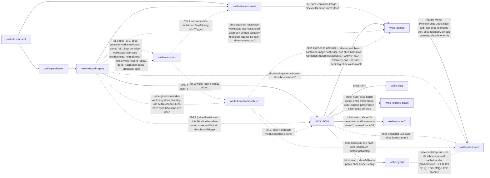

# Roadmap

**Format-Regel:** Die Roadmap ist eine Reihenfolge von **Wellen**,
keine Reihenfolge von Terminen (siehe
Baseline-Regelwerk `modul-06-roadmap.md`).
Termine werden — falls überhaupt — als Konsequenz der Wellen-Schätzung
gezeigt, nicht als Treiber.

---

## Offene Wellen

Regeln dieser Sektion: Baseline-Regelwerk `modul-06-roadmap.md`
§Roadmap-Struktur: fünf Abschnitte — *Offene Wellen* ist **derivativ**: Der
Zustand sind die flachen Welle-Dateien; woran gearbeitet wird, sagt das
`Welle:`-Feld der Slices in `in-progress/`. Ziel, Trigger und
Closure-Kriterien stehen in der Welle-Datei, nicht hier.

- ohne Welle: [slice-mutationslauf-werkzeug](../done/slice-mutationslauf-werkzeug.md) (in `done/`, Linie C, nicht produktiv; Vertrag [SPEC-210](../../../../harness/vertraege/SPEC-210-mutationslauf.md); beim User offen: Cache über Läufe, Aufruf durch die Rollen, Gate für das Modul, Formelkonflikt, siehe §7 des Plans)
- ohne Welle: [slice-mutationslauf-modulwurzel](../open/slice-mutationslauf-modulwurzel.md) (angelegt in `open/`, Linie C, nicht produktiv, kein Slice der Gate-Kette; Mutationslauf für Pakete an der Wurzel eines Moduls unter `tools/`, `SPEC-210`; Geber `slice-handbuch-meldungskatalog`)
- ohne Welle: [slice-gate-integration-determinism](../in-progress/slice-gate-integration-determinism.md) (in Arbeit seit 2026-11-08, Linie C, hält die Gate-Kette (Nr. 7 der [Übergangsregeln](../README.md#parallelbetrieb-in-worktrees-übergangsregeln)); `make test-integration` und `make test-determinism` in `GATE_CHECKS`, vorläufige Marke 1400; Berührung mit `slice-bootstrap-m3` am Treiber und an der Stufe `integration`, siehe §4 des Plans; `slice-test-contract` und `slice-guard-schreibwege` warten)
- ohne Welle: [slice-sqlite-interrupt-transaktion](../done/slice-sqlite-interrupt-transaktion.md) (geliefert, Linie REPO; Behebung des Rot von `TestTransaktionVertrag` im Adapter `sqlite`: Interrupt des Treibers bei Kontext-Abbruch rollte die offene Transaktion zurück, behoben im Adapter, Vertrag `SPEC-108` Nr. 1, Messung 1796 von Marke 2700, Rate unter Last 0 von 2400 gegen 457; Register `BEO-REPO/sqlite-transaktionsvertrag-rot-unter-last`; berührt die Gate-Kette nicht, Nr. 7 der Übergangsregeln frei)
- ohne Welle: [slice-v4-schreiber-marker-text](../done/slice-v4-schreiber-marker-text.md) (in `done/`, Linie B; der Text `[REDACTED]` im V4-Schreiber, `SPEC-168` und `SPEC-169`, Beleg Verifikations-Report `docs/reviews/2026-11-07-slice-v4-schreiber-marker-text-verifikation.md`)
- [welle-mock](../welle-mock.md) (gestaffelt: Trigger von Teil 1, den reinen Funktionen, eingetreten durch [slice-baseline-import](../done/slice-baseline-import.md); der Trigger von Teil 2, `slice-handbuch-meldungskatalog` in `done/` (`welle-record-replay` liegt in `done/`), ist eingetreten; geliefert: [slice-mock-zuordnung](../done/slice-mock-zuordnung.md) (Teil 1 des Schnitts von `slice-mock-lesen`), Linie B, Vertrag `SPEC-195` bis `SPEC-199` vom Architect geschrieben; geliefert: [slice-mock-lesen](../done/slice-mock-lesen.md) (Teil 2 des Schnitts, Linie B, `SPEC-196` bis `SPEC-199`, Code `ODR-E6008`; Teil 1 und 2 in `done/`); geliefert: [slice-mock-schreiben](../done/slice-mock-schreiben.md) (Linie B, `SPEC-192` bis `SPEC-194`, Code `ODR-E6009`; der Trigger von `slice-snapshot-use-case` ist eingetreten; M3 offen: Kette `slice-snapshot-use-case`, `slice-mock-abnahme`, `slice-bootstrap-m3`); geliefert: [slice-snapshot-use-case](../done/slice-snapshot-use-case.md) (Linie B, `SPEC-129` Nr. 16 bis 26, kein neuer Code, Messung 5581 von Marke 10600; geliefert: [slice-mock-abnahme](../done/slice-mock-abnahme.md) (Linie B, `SPEC-049` Nr. 1 bis 10, nur Tests, Messung 2335 von Marke 9700), M3 offen: [slice-bootstrap-m3](../done/slice-bootstrap-m3.md) in Arbeit (`in-progress/`, Linie B, Zweig `slice-bootstrap-m3`; Teil E davon als [slice-bootstrap-m3-e2e-mock](../open/slice-bootstrap-m3-e2e-mock.md), `open/`, Linie B, nach `slice-bootstrap-m3`; [slice-handbuch-mock](../open/slice-handbuch-mock.md), `open/`, Linie C, Kettenslice, nach `slice-bootstrap-m3`, Voraussetzung des Closure-Triggers der Welle); beim User offen: Kennungsfrage R2 und `ODR-E5004` für Workspace-Snapshots R3, siehe §6 des Plans; Merge-Nähe: `slice-admin-rahmen` und `slice-sqlite-interrupt-transaktion` mergen später, die Zahl der Codes gleicht, wer als zweiter nach `main` merged, siehe [welle-mock](../welle-mock.md) §5); geliefert: [slice-odata-url-pfad](../done/slice-odata-url-pfad.md), Linie B; geliefert: [slice-odata-url-filter](../done/slice-odata-url-filter.md), Linie B; geliefert: [slice-edm-ausdruecke](../done/slice-edm-ausdruecke.md), Linie B, `SPEC-166` und `SPEC-167`, geliefert: [slice-query-interpreter](../done/slice-query-interpreter.md), Linie B, `SPEC-190` und `SPEC-191`; geliefert: [slice-odata-json-schreiben](../done/slice-odata-json-schreiben.md), Linie B, `SPEC-168` und `SPEC-169`; geliefert: [slice-odata-json-eingabe](../done/slice-odata-json-eingabe.md), Linie B, `SPEC-180` und `SPEC-181`)
- [welle-sensoren](../welle-sensoren.md) (gestaffelt: Trigger von Teil 0 und Teil 1, `slice-groessenmarke-werkzeug`, eingetreten, Beleg [done/](../done/slice-groessenmarke-werkzeug.md); Trigger von Teil 2, `welle-record-replay` in `done/`, eingetreten, Teil 2 beginnt nach `slice-guide-groessen-gate`; geliefert: `slice-unsichtbare-zeichen` in [done/](../done/slice-unsichtbare-zeichen.md), Beleg `make zeichen-check`; geliefert: `slice-guide-groessen-gate` in [done/](../done/slice-guide-groessen-gate.md), Beleg `make docs-check`, Linie C)
- [welle-odata-v2](../welle-odata-v2.md) (Ausnahme je Slice: `slice-v2-import-codecs`, `slice-v2-metadaten`, `slice-v2-payload-lesen` und `slice-v2-query` brauchen nur die ADR [ADR-0011](../../adr/0011-versionierter-adapter-fuer-odata-v2.md) und den V2-Umfang der Spezifikation, nicht `welle-mock`; geliefert: `slice-v2-import-codecs` in [done/](../done/slice-v2-import-codecs.md) und `slice-v2-metadaten` in [done/](../done/slice-v2-metadaten.md); geliefert: `slice-v2-payload-lesen` in [done/](../done/slice-v2-payload-lesen.md), Beleg `make gates`, ein akzeptiertes Negativ offen (Planner, Zuweisung bei der Closure der Welle); geliefert: `slice-v2-query` (Teil A) in [done/](../done/slice-v2-query.md); geliefert: `slice-v2-query-filter` (Teil B) in [in-progress/](../done/slice-v2-query-filter.md), Beleg `make gates`, vier akzeptierte Negative offen (Planner, Zuweisung bei der Closure der Welle); geliefert: `slice-v2-payload-schreiben` in [done/](../done/slice-v2-payload-schreiben.md), Linie B, `SPEC-172` Nr. 6 h bis o und Nr. 7, Beleg `make gates`; beim User offen: Kennungsbereich der Linie B (`SPEC-160` bis `SPEC-199` fast erschöpft, `slice-mock-lesen` nimmt `SPEC-195` bis `SPEC-199`, frei bleiben `SPEC-192` bis `SPEC-194`; der Bereich von Linie A, `SPEC-129` bis `SPEC-159`, ist frei, siehe §7 des Plans); `slice-v2-bootstrap` auf `welle-mock` und die V2-Slices davor)
- [welle-benutzerhandbuch](../welle-benutzerhandbuch.md) (gestartet: `slice-handbuch-geruest` in [done/](../done/slice-handbuch-geruest.md), Beleg `make handbuch-check`; `slice-bootstrap-m2` liegt in `done/`; geliefert: [slice-handbuch-meldungskatalog](../done/slice-handbuch-meldungskatalog.md), Linie C, Beleg `make katalog-check`; geliefert: [slice-handbuch-katalog-schluessel-kommandos](../done/slice-handbuch-katalog-schluessel-kommandos.md) (Linie C, Beleg `make katalog-check` für Schlüssel und Kommandos, Messung 2163 von Marke 3000; Nr. 7 der Übergangsregeln seit 2026-11-08 gehalten von `slice-gate-integration-determinism`; `slice-test-contract` und `slice-guard-schreibwege` warten, immer nur einer zugleich); beim User offen: Laufzeit von `make gegenproben` bei geänderter Eingabe über dem Budget von 120 s ([ADR-0005](../../adr/0005-gegenproben-ausserhalb-der-gate-kette.md), siehe §6 und §7 des Plans) und der Vorschlag, die Pflicht aus `SPEC-201` Nr. 11 (wer einen Code, Schlüssel oder ein Kommando erreichbar macht, ändert Ausnahmen und Handbuch im selben Slice) in `AGENTS.md` oder `implement-slice.md` zu verkörpern; Aufzeichnen- und Abnahme-Slice folgen)

**Lesart:** Eine Welle steht hier, wenn ihr Trigger eingetreten ist oder ihr erster Slice gestartet ist; sonst steht sie unter *Nächste Wellen* mit Link auf ihre Datei. Bei einer Welle mit gestaffeltem Start (`welle-sensoren`, `welle-mock`) zählt der Trigger ihres ersten Teils. Ein einzelner Slice, der vor dem Trigger seiner Welle starten darf, weil kein Code der Vorgänger-Welle fehlt, ist eine Ausnahme je Slice (Zusatz in der Welle-Datei, Spalte *Trigger* unten) und verschiebt die Welle nicht; so steht `welle-betrieb` unter *Nächste Wellen*, obwohl `slice-audit-log` (Linie D) läuft. `welle-benutzerhandbuch` steht hier, weil mit dem Gerüst ihr erster Slice läuft: Der Trigger der Welle (Werkzeug für die Marke) ist für diesen Zweck erfüllt, weil das Werkzeug in `main` lauffähig ist.

## Nächste Wellen

Regeln dieser Sektion: Baseline-Regelwerk `modul-06-roadmap.md`
§Roadmap-Struktur: fünf Abschnitte, Bullet *Nächste Wellen* — die geordnete
Vorschau: je Zeile Welle, Trigger als beobachtbare Bedingung, wichtigste Slices
und geschätzter Aufwand (S/M/L, kein Termin).

| Welle | Trigger | Wichtigste Slices | Geschätzter Aufwand |
|---|---|---|---|
| [welle-dev-container](../welle-dev-container.md) | `welle-fundament` und `welle-record-replay` liegen in `done/` (M2 erreicht) | Arbeitscontainer mit eigenem Docker-Daemon und Limits, SSH-Zugang, Einlieferung per Zweig, `make gates` und `make gegenproben` im Container, Dokument für Entwickler | M |
| [welle-hybrid](../welle-hybrid.md) | welle-mock done (M3 erreicht); Ausnahme je Slice: `slice-fallback-policy` hat keinen Code-Bezug zu `welle-mock`, ein Start davor ist offen (Entscheidung des Users, Umplanung hier) | Fallback-Policy, `HybridUseCase`, Modus `hybrid` im Composition Root | M |
| [welle-betrieb](../welle-betrieb.md) | welle-mock done (M3 erreicht); `slice-container-image` zusätzlich nach `welle-dev-container` in `done/`. Ausnahmen je Slice, ohne `welle-mock`: `slice-telemetry-port` (in [done/](../done/slice-telemetry-port.md)), [slice-telemetry-log](../done/slice-telemetry-log.md) (Teil `L` geliefert, Linie D: Zeile, Senke und Sperre; Teil `H` ist [slice-telemetry-handler](../done/slice-telemetry-handler.md) (geliefert, Linie D: `Handler()` des Adapters; das Binary blieb unverändert); [slice-telemetry-spans](../done/slice-telemetry-spans.md) (geliefert, Linie D: Spans, Verteilung, Ring und Span-Zeile des Adapters; Teil `S`; das Binary blieb unverändert); `slice-telemetry-einbau-gateway` ist nach der Telemetrie startbar und wartet auf die Entscheidung des Users zu L16, `slice-telemetry-einbau-mock` zusätzlich auf `slice-snapshot-use-case` und `slice-bootstrap-m3`; `slice-mock-schreiben` liegt in `done/`), `slice-audit-log` (Teil A geliefert: [done/](../done/slice-audit-log.md), Linie D) mit den Teilen [slice-audit-dienste](../done/slice-audit-dienste.md) (Closure Phase 1, Linie D, mit Brücke im Composition Root) und [slice-audit-verdrahtung](../done/slice-audit-verdrahtung.md) (Closure Phase 1, Linie D; verkleinert auf die Fänger der Datei im Betrieb, Produktcode 0), ab M2 `slice-telemetry-einbau-gateway`, `slice-listener-tls`, `slice-container-image` | Port `Telemetry` und Einbau in alle Pfade, `AuditLog`, TLS des Listeners, Container-Image mit Neustarttest, Lasttest zu `LH-QA-01` (Zielwert: Entscheidung des Users offen, Frist vor `slice-lasttest`) | L |
| [welle-admin-api](../welle-admin-api.md) | welle-betrieb done (M5 erreicht; Priorisierung, keine Code-Abhängigkeit). Code-Kanten nach `welle-betrieb`: `slice-audit-log`, `slice-telemetry-port`, `slice-telemetry-einbau-gateway`, `slice-listener-tls`; `slice-inspection-use-case` (Exchanges) braucht keinen Slice von `welle-betrieb`, `slice-inspection-coverage-diagnose` nur `slice-telemetry-port` und `slice-inspection-use-case`, `slice-admin-listener-token` auch `slice-telemetry-port`. Ausnahme je Slice, ohne Welle-Trigger: [slice-inspection-use-case](../done/slice-inspection-use-case.md) (geliefert, Linie D; Teil 1 des Schnitts vor dem Code) mit Teil 2 [slice-inspection-coverage-diagnose](../done/slice-inspection-coverage-diagnose.md) (geliefert, Linie D; `InspectionUseCase` komplett); [slice-admin-listener-token](../done/slice-admin-listener-token.md) (geliefert, Linie D; Teil 1 des Schnitts vor dem Code, die Token-Datei; Vertrag `SPEC-238` bis `SPEC-240` auf `main`; Binary unverändert) mit den Teilen 2 bis 6 in `open/`, nacheinander: [slice-admin-rahmen](../done/slice-admin-rahmen.md) (geliefert, Linie D; Konfiguration, Routen, Zuordnung, Code `ODR-E2102` als 40. Code; Binary unverändert), [slice-admin-authentisierung](../done/slice-admin-authentisierung.md) (geliefert, Linie D; Teil 3, Ablauf, Authentisierung, Antwort und die Sendung A7 von `slice-admin-rahmen`; Binary unverändert, Messung 1537 von Marke 2600), [slice-admin-lebenszyklus](../open/slice-admin-lebenszyklus.md) (Serve, Anhalten, Schliessen), [slice-admin-fehlerabbildung](../open/slice-admin-fehlerabbildung.md) (Fehler der Routen, Zählen) und [slice-admin-abweisen-audit](../open/slice-admin-abweisen-audit.md) (Audit des Abweisens, Art `admin_abgewiesen`) | `InspectionUseCase`, Admin-Listener mit Token und Transportschutz, Endpunkte für Sessions, Imports, Workspaces und Snapshots, Sicherheitsnachweis | L |
| [welle-etag](../welle-etag.md) | welle-mock done (M3 erreicht); keine Ausnahme je Slice | ETag, `If-Match` mit `412`, `Prefer` (Soll) | S |
| [welle-expand-batch](../welle-expand-batch.md) | welle-mock done (M3 erreicht). Ausnahmen je Slice: `slice-batch-parser` ohne `welle-mock`, `slice-expand-parser` nach `slice-odata-url-pfad`; `slice-expand-ausfuehrung` zusätzlich nach der Entscheidung des Architect zur Datenbasis | `$expand`, `$batch` mit atomaren Changesets (Soll) | M |

## Meilensteine

Regeln dieser Sektion: Baseline-Regelwerk `modul-06-roadmap.md`
§Welle ≠ Meilenstein ≠ Release.

| Meilenstein | Welle(n) | Trigger | Status |
|---|---|---|---|
| M1 | welle-fundament | `make gates` fährt Build, Test, Lint und `a-check` auf Go-Code, jedes durch eine Gegenprobe belegt | erreicht — [slice-gegenproben-build-test](../done/slice-gegenproben-build-test.md) |
| M2 | welle-record-replay | Ein Test zeichnet gegen einen Referenzdienst auf und spielt ohne Upstream wieder ab | erreicht — `TestDurchstichM2` (`tests/integration/m2_test.go`, Teil von `make test`) |
| M3 | welle-mock | Ein Test beantwortet aus einer importierten Baseline `$metadata` und Abfragen mit Optionen, ändert und löscht Entities mit sichtbaren Zustandsübergängen, stellt einen Snapshot wieder her und setzt zurück, ohne Upstream | offen |
| M4 | welle-hybrid | Ein Test belegt am Verbindungszähler eines Referenzdienstes, dass im Modus `hybrid` nur freigegebene lesende Anfragen den Upstream erreichen und ein POST ohne Freigabe nie | offen |
| M5 | welle-betrieb | Der Lasttest nach `LH-QA-01.a` läuft reproduzierbar und weist p95 aus dem Gesamtspan für Replay und Mock aus | offen |
| M6 | welle-admin-api | Ein Test steuert Aufzeichnung, Import, Workspace, Snapshot und Reset ausschließlich über den Admin-Listener mit Token und weist Anfragen ohne Token ab | offen; Entscheidung des Users ausstehend: Begrenzung der Fehlversuche (`LH-FA-13.a` nennt keine) und Umfang der Audit-Einträge des Abweisens (jede Abweisung ein Eintrag ohne Drosselung), siehe [welle-admin-api](../welle-admin-api.md) §5 |
| M7 | welle-record-replay, welle-mock, welle-hybrid, welle-betrieb, welle-admin-api, welle-dev-container | Erstabnahme: alle Muss-Anforderungen des Lastenhefts haben einen Beleg, der fachliche Owner hat den Zielwert von `LH-QA-01` bestätigt, und das Lastenheft trägt den Status `Accepted` | offen; Zielwert `LH-QA-01` ungeklärt, Adresse: User, Frist vor Start von `slice-lasttest` ([Bericht](../../../reviews/2026-10-30-lastenheft-wellen-abgleich.md) §10 Nr. 8) |

## Abhängigkeitsgraph

Regeln dieser Sektion: Baseline-Regelwerk `modul-06-roadmap.md`
§Roadmap-Struktur: fünf Abschnitte, Bullet *Nächste Wellen* — die Abhängigkeit
steht als beobachtbare Bedingung in der `Trigger`-Spalte **und** als gerichtete
Kante hier; eine Welle, die ohne fertige Vorgängerin nicht starten kann, ist
eine Phantom-Welle.

## Abgeschlossene Wellen

Regeln dieser Sektion: Baseline-Regelwerk `modul-06-roadmap.md`
§Roadmap-Struktur: fünf Abschnitte.

| Welle | Abschluss | Closure-Notiz |
|---|---|---|
| welle-fundament | 2026-10-19 | [welle-fundament-results](../done/welle-fundament-results.md) |
| welle-persistenz | 2026-10-20 | [welle-persistenz-results](../done/welle-persistenz-results.md) |
| welle-record-replay | 2026-11-06 | [welle-record-replay-results](../done/welle-record-replay-results.md) |

## Historische Trigger-Verschiebungen

Regeln dieser Sektion: Baseline-Regelwerk `modul-06-roadmap.md`
§Roadmap-Struktur: fünf Abschnitte, Bullet *Historische Trigger-Verschiebungen*
— das Drift-Log: jede Umplanung mit Datum, Änderung, Grund. Leer heißt starre
Roadmap, jede Zeile voll heißt treibende.

| Datum | Was wurde geändert? | Warum? |
|---|---|---|
| 2026-10-21 | [welle-record-replay](../done/welle-record-replay.md): [slice-record-service](../done/slice-record-service.md) vor dem ersten Code-Commit geschnitten; der Adapter `httpupstream` ist [slice-upstream-adapter](../done/slice-upstream-adapter.md), nach `slice-record-service` und vor `slice-bootstrap-m2`; die Welle führt 15 Slices statt 14 | Schätzung rund 4700 Zeilen und drei Schichten (Outbound Port, Dienst, Driven Adapter) in einem Slice; ein Schnitt vor dem Code statt einer Rückführung danach, die bei zehn Überschreitungen keinmal genommen wurde (`BEO-REPO/groessenmarke-ueberschritten-ohne-rueckfuehrung`) |
| 2026-10-21 | [welle-record-replay](../done/welle-record-replay.md): [slice-upstream-adapter](../done/slice-upstream-adapter.md) beim Handoff geschnitten; die TLS-Konfiguration des Adapters (`CAPEM`, `Pruefen`, HTTP/1.1 über TLS) ist [slice-upstream-tls](../done/slice-upstream-tls.md), nach `slice-upstream-adapter` und vor `slice-bootstrap-m2`; die Welle führt 16 Slices statt 15 | Handoff 2831 Zeilen über der Schwelle 2500 aus §4 des Plans; ohne Schnitt hielte die Marke 2900 nur bei höchstens 69 Zeilen Zuwachs im Review, gemessen waren in den Vorgängern 12,3 und 16,1 %; der Schnitt war vorab benannt und durch die Auflage (TLS-Teil zuletzt, in eigenem Commit) nach dem Code nehmbar |
| 2026-10-21 | [welle-record-replay](../done/welle-record-replay.md): [slice-race-gate](../done/slice-race-gate.md) neu, vor `slice-http-adapter`, dessen Start ihn in `done/` verlangt; [slice-protokolltreue](../done/slice-protokolltreue.md) neu, nach `slice-bootstrap-m2` als letzter Slice; die Welle führt 18 Slices statt 16 | Entscheidung des Users zu den Beobachtungen über der Schwelle: `BEO-REPO/nebenlaeufiger-lauf-nur-im-glueck-gruen` (5×) bekommt den Ausgang `geplant` mit einem Race-Detektor im Gate; der Vergleichstest der Messmethode von `LH-QA-07` hatte in der Welle keinen Träger, und `slice-bootstrap-m2` bleibt beim Satz von M2 |
| 2026-10-23 | [welle-record-replay](../done/welle-record-replay.md): [slice-session-wartung](../done/slice-session-wartung.md) beim Start vor dem ersten Code-Commit geschnitten; `SessionUseCase` ist [slice-session-use-case](../done/slice-session-use-case.md), nach `slice-session-wartung` (`MaintenanceUseCase`) und vor `slice-baseline-import` und `slice-bootstrap-m2`; die Welle führt 19 Slices statt 18 | Schätzung beider Use Cases in einem Slice rund 3250 bis 3750 Zeilen (Tabelle × 85 bzw. 40, plus Port-Fakes, × 1,25), über der Grenze 3000 aus `AGENTS.md` §3.14; ein Schnitt vor dem Code statt einer Rückführung danach (`BEO-REPO/groessenmarke-ueberschritten-ohne-rueckfuehrung`); gemeinsam ist nur der Port der Bereinigung |
| 2026-10-23 | [welle-record-replay](../done/welle-record-replay.md): [slice-session-use-case](../done/slice-session-use-case.md) beim Start vor dem ersten Code-Commit geschnitten; das Beenden (`Drain`, Statusregel, `CloseAll`) ist [slice-session-beenden](../done/slice-session-beenden.md), nach `slice-session-use-case` und vor `slice-bootstrap-m2`; die Welle führt 20 Slices statt 19 | Schätzung beider Teile in einem Slice rund 3300 Zeilen (30 Zeilen der Tabelle, 9 nebenläufig, 5 Port-Fakes, × 1,25), über der Grenze 3000 aus `AGENTS.md` §3.14; ein Schnitt vor dem Code statt einer Rückführung danach; gemeinsam sind Konstruktor, Konfig, Fehlerabbildung und die Fakes des Pakets |
| 2026-10-25 | [welle-record-replay](../done/welle-record-replay.md): [slice-groessenmarke-werkzeug](../done/slice-groessenmarke-werkzeug.md) neu, nach `slice-baseline-import` und vor `slice-workspace-use-case`; die Welle führt 21 Slices statt 20 | Entscheidung des Users zu `BEO-REPO/groessenmarke-ueberschritten-ohne-rueckfuehrung` (16×): Ausgang `geplant` mit einem Werkzeug statt einer Prosa-Regel, denn die Formel der Platte verfehlt zwei von drei Messpunkten; das Werkzeug soll vor der nächsten Marke (`slice-workspace-use-case`) liegen; die Einordnung in die Welle ist vom User bestätigt |
| 2026-10-30 | Reihenfolge der Wellen: [welle-sensoren](../welle-sensoren.md) startet gestaffelt, Teil 1 (`slice-unsichtbare-zeichen`, `slice-guide-groessen-gate`) nach `slice-groessenmarke-werkzeug` und vor `slice-workspace-use-case` (Reihenfolge, kein Blocker), Teil 2 (`slice-abdeckung-deklaration`, `slice-coverage-gate`) nach `welle-record-replay`; [welle-dev-container](../welle-dev-container.md) startet nach `welle-record-replay` (Trigger vorher nur `welle-fundament`), Kante zu `slice-container-image` von [welle-betrieb](../welle-betrieb.md); `slice-handbuch-geruest` nach Teil 1; `slice-cli-kommandos` entfällt, [welle-admin-api](../welle-admin-api.md) führt 8 Slices statt 9 | Teil 1 schützt jede Datei, die die folgenden Slices schreiben, und friert die Größe der Guide-Dateien ein, ohne `src/` zu berühren; Teil 2 (Backfill über 618 Testfunktionen in 105 Dateien, Schwelle gegen den Code von M2) kollidiert mit den Dateien, die die Slices von M2 schreiben; der Arbeitscontainer fährt eine Gate-Kette, die nach M2 stabil ist, und der Neustarttest von `slice-container-image` braucht dessen Docker-Daemon; kein Anker im Lastenheft für Kommandos über Start und Version hinaus (`LH-FA-13` verlangt eine Verwaltungsschnittstelle). Entscheidungen des Users zum Abgleich [Lastenheft gegen Wellen](../../../reviews/2026-10-30-lastenheft-wellen-abgleich.md) |
| 2026-10-30 | [welle-mock](../welle-mock.md) startet gestaffelt: Teil 1 (`slice-odata-url-pfad`, `slice-odata-url-filter`, `slice-edm-ausdruecke`, `slice-query-interpreter`, `slice-odata-json-schreiben`, `slice-odata-json-eingabe`) mit dem Trigger `slice-baseline-import` in `done/` (erfüllt), die Welle steht unter *Offene Wellen*; Teil 2 (`slice-mock-lesen`, `slice-mock-schreiben`, `slice-snapshot-use-case`, `slice-mock-abnahme`, `slice-bootstrap-m3`) behält den Trigger (`welle-record-replay` und `slice-handbuch-meldungskatalog` in `done/`); Parallelbetrieb produktiver Slices in Worktrees mit [Übergangsregeln](../README.md#parallelbetrieb-in-worktrees-übergangsregeln) (Sperre für schwere Läufe, Stempel im Integrationsschritt, Kennungsbereiche je Linie); [slice-worktree-parallel](../open/slice-worktree-parallel.md) neu als Teil 0 von [welle-sensoren](../welle-sensoren.md), nicht-produktiv, blockiert nichts; die Welle führt 5 Slices statt 4 | Entscheidung des Users: produktive Slices und Wellen sollen jetzt parallel in Worktrees laufen, der Werkzeug-Slice darf sie nicht blockieren. Die sechs Slices von Teil 1 sind reine Funktionen und Codecs auf Modell und Codec zum Lesen, ohne Port-Anbindung und ohne sichtbares Verhalten am Binary; sie brauchen weder `welle-record-replay` noch das Handbuch-Gerüst. Die Antwort des Users auf Frage 7 des Abgleichs („frühestens nach `welle-dev-container`“) ist damit durch die Übergangsregeln ersetzt |
| 2026-10-30 | Start-Trigger je Slice statt je Welle: die Slice-Pläne von [welle-hybrid](../welle-hybrid.md), [welle-betrieb](../welle-betrieb.md), [welle-admin-api](../welle-admin-api.md), [welle-etag](../welle-etag.md), [welle-expand-batch](../welle-expand-batch.md) und [welle-odata-v2](../welle-odata-v2.md) liegen in `open/` und tragen ihre Abhängigkeiten; Wellen-Trigger bleiben formal, Ausnahmen je Slice stehen in den Welle-Dateien (§2). Gestartet vor dem Welle-Trigger: `slice-telemetry-port` (Linie D, Kennungsbereich in den [Übergangsregeln](../README.md#parallelbetrieb-in-worktrees-übergangsregeln)); `slice-handbuch-geruest` vor Teil 1 von [welle-sensoren](../welle-sensoren.md) und vor `slice-groessenmarke-werkzeug` in `done/`, [welle-benutzerhandbuch](../welle-benutzerhandbuch.md) steht damit unter *Offene Wellen*; `slice-workspace-use-case` (Linie A) vor der Closure des Werkzeug-Slice. `welle-betrieb` bleibt unter *Nächste Wellen* | Entscheidung des Users: Slice-Pläne aller Produkt-Wellen jetzt anlegen, Abhängigkeiten in den Plänen führen und freie Linien in eigenen Worktrees starten. Die Pläne zeigen Slices ohne Code-Bezug zum Trigger ihrer Welle (`slice-telemetry-port`, `slice-audit-log`, `slice-batch-parser`, `slice-v2-metadaten`, `slice-fallback-policy`); der Start von `slice-telemetry-port` ist eine Ausnahme je Slice und nicht der Start der Welle, deren Closure (Spans von Mock und Workspace, Lasttest) `welle-mock` voraussetzt |
| 2026-10-31 | [welle-record-replay](../done/welle-record-replay.md): [slice-http-lebenszyklus](../done/slice-http-lebenszyklus.md) neu, aus [slice-http-adapter](../done/slice-http-adapter.md) vor dem Code geschnitten, nach dem Kern und vor `slice-bootstrap-m2`; [slice-cli-adapter](../done/slice-cli-adapter.md) neu (`ARC-006`), vor `slice-bootstrap-m2`; [slice-test-integration](../done/slice-test-integration.md) (`SPEC-037`) und [slice-test-determinism](../done/slice-test-determinism.md) (`SPEC-038`) neu, nach `slice-bootstrap-m2`; die Welle führt 25 Slices statt 21. [welle-mock](../welle-mock.md): [slice-test-contract](../open/slice-test-contract.md) (`SPEC-042`) neu, nach `slice-bootstrap-m3`; `slice-bootstrap-m3`, `-m4` und `-m6` führen je ein Szenario von `make test-integration` in der DoD. Rückverfolgungs-Matrix [rueckverfolgung](../rueckverfolgung.md) neu | Schätzung des Architect zu `slice-http-adapter`: 3525 Zeilen, Marke 4800, über der Grenze 3000 aus `AGENTS.md` §3.14; der Lebenszyklus ist der einzige Teil ohne geteilten Mechanismus mit dem Kern. `ARC-006` (CLI) und die Verträge `SPEC-037`, `SPEC-038`, `SPEC-042` hatten keinen Träger in einem Plan; kein Test fuhr das gebaute Binary, obwohl `LH-RB-03.a` einen End-to-End-Test als Nachweis nennt. Entscheidung des Users: das lauffähige Produkt (Durchstich M2) hat Vorrang, die Absicherung folgt danach |
| 2026-11-01 | [welle-record-replay](../done/welle-record-replay.md): [slice-m2-referenzdienst](../done/slice-m2-referenzdienst.md) neu, aus `slice-bootstrap-m2` vor dem ersten Code-Commit geschnitten, nach ihm und vor [slice-protokolltreue](../done/slice-protokolltreue.md); `slice-bootstrap-m2` liefert den Root-Kern, der Referenzdienst, die Verdrahtung von Import und Workspace und der M2-Test wandern; die Welle führt 26 Slices statt 25; die Zelle M2 bleibt offen bis zur Closure der Welle | Schätzung des Architect: beide Hälften zusammen S rund 3200 (Marke 4400, Schnittfrage ab 2223 nach `SPEC-128`), der Kern allein S = 2120 (Marke 2900); der Schnitt teilt keinen Mechanismus, denn Referenzdienst, Import und Workspace sind additive Zugänge am `Handle`. Nehmer nachgezogen (`AGENTS.md` §3.13): `slice-protokolltreue`, `slice-test-integration`, `slice-test-determinism`, `slice-handbuch-record-replay`, `slice-bootstrap-m3`, `-m4`, `-m6`, `slice-abdeckung-deklaration`, `slice-test-security` |
| 2026-11-01 | [welle-record-replay](../done/welle-record-replay.md): [slice-text-antworten](../done/slice-text-antworten.md) neu, nach [slice-m2-referenzdienst](../done/slice-m2-referenzdienst.md) und vor [slice-protokolltreue](../done/slice-protokolltreue.md); die Welle führt 27 Slices statt 26 | Befund des Reviews zu `slice-m2-referenzdienst`: `text/*` war nicht aufzeichenbar (`SPEC-118` Nr. 3), obwohl `/$count` als `text/plain` beschrieben ist. Entscheidung des Owners: `text/*` ist bekannt bei `/$count` und `/<Property>/$value`, sonst unbekannt (Wortlaut `SPEC-118` Nr. 11, vor dem Code in der Spezifikation, keine ADR, Lastenheft unberührt). Der Slice ändert Produktcode (Redaktor, Record-Dienst) und den Referenzdienst, `slice-protokolltreue` nur einen Test; der Durchstich M2 bleibt bei JSON-`$count`. Nehmer nachgezogen (`AGENTS.md` §3.13): `slice-protokolltreue`; der Geber `slice-m2-referenzdienst` trägt die Sendung im Zweig |
| 2026-11-01 | [welle-odata-v2](../welle-odata-v2.md): nach [ADR-0011](../../adr/0011-versionierter-adapter-fuer-odata-v2.md) neu `slice-v2-import-codecs` (vor `slice-v2-bootstrap`), `slice-v2-payload` geschnitten in `slice-v2-payload-lesen` und `slice-v2-payload-schreiben`; die Kette metadaten, payload, query, bootstrap entfällt, vier Slices starten ohne `welle-mock`; die Welle führt 6 Slices statt 4 | Der Architect entschied den Import je Version (derselbe Importer, Satz je Dienst) und schnitt die Nutzlast an der Tabelle der Typen, die nur die Spezifikation teilt; der Parser kennt das Modell nicht, das Modell ist derselbe Typ. Nehmer nachgezogen (`AGENTS.md` §3.13): `slice-mock-lesen`, `slice-odata-json-schreiben`, `slice-bootstrap-m3` |
| 2026-11-01 | [welle-odata-v2](../welle-odata-v2.md): `slice-v2-query` geschnitten in `slice-v2-query` (Pfad, Optionen, Kompatibilitätsfehler, Einhängestelle `WithFilter`) und neu [slice-v2-query-filter](../done/slice-v2-query-filter.md) (Leser von `$filter`), Reihenfolge `slice-v2-query`, `slice-v2-query-filter`, `slice-v2-bootstrap`; die Welle führt 7 Slices statt 6 | Der Architect schnitt vor dem Code (Schätzung ungeschnitten 8500, Schwelle 2223 nach `SPEC-128`): die Grammatik von `$filter` teilt mit dem Rest allein die Literal-Funktion und die Einhängestelle. Nehmer nachgezogen (`AGENTS.md` §3.13): `slice-v2-bootstrap` |
| 2026-11-06 | Linie C (Gate-Kette): [slice-gate-integration-determinism](../in-progress/slice-gate-integration-determinism.md) und [slice-guard-schreibwege](../open/slice-guard-schreibwege.md) neu, beide ohne Welle, nach der Closure von `welle-record-replay` und nicht zugleich mit einem anderen Slice der Kette (Nr. 7 der [Übergangsregeln](../README.md#parallelbetrieb-in-worktrees-übergangsregeln)); die Reihenfolge zu den Slices von Teil 2 von [welle-sensoren](../welle-sensoren.md) legt der Start fest | Entscheidung des Users zur Closure: `make test-integration` und `make test-determinism` kommen in `GATE_CHECKS` (Register `BEO-REPO/pflichtlauf-neben-der-gate-kette-ohne-traeger`), und die Betriebsregel „Repo-Dateien nur mit `Edit` und `Write`“ bekommt einen Wächter im Command-Guard (`BEO-REPO/betriebsregel-fuer-repo-dateien-verletzt`, 4×) |
| 2026-11-06 | [welle-betrieb](../welle-betrieb.md): `slice-audit-log` ist vor dem Code in drei Slices geschnitten, zwei neue Pläne in [open/](../done/slice-audit-dienste.md) (`slice-audit-dienste`, [slice-audit-verdrahtung](../done/slice-audit-verdrahtung.md)); die Start-Bedingung von `slice-admin-sessions`, `slice-admin-workspaces` und `slice-admin-imports` nennt zusätzlich `slice-audit-dienste` | Schätzung der ungeschnittenen Tabelle 4815 liegt über der Schwelle der Schnittfrage (`SPEC-128` Nr. 1); die Einträge der Löschungen entstehen erst in den Diensten, und die Admin-Slices dürfen sie nicht doppeln |
| 2026-11-06 | [welle-betrieb](../welle-betrieb.md): [slice-audit-verdrahtung](../done/slice-audit-verdrahtung.md) auf die Fänger der Datei im Betrieb verkleinert (Marke 500 statt 600), die Verdrahtung im Composition Root liegt als Brücke in [slice-audit-dienste](../done/slice-audit-dienste.md) | ohne die Übergabe von `Audit` scheitert `Build` (`SPEC-234` Nr. 8), zwischen den beiden Slices bestünde kein grüner Stand |
| 2026-11-07 | [welle-betrieb](../welle-betrieb.md): [slice-telemetry-log](../done/slice-telemetry-log.md) ist vor dem Code in zwei Teile geschnitten, neu [slice-telemetry-handler](../done/slice-telemetry-handler.md) (`Handler()`, Arten, `WithAttrs`, `WithGroup`, Abbildung der Dienste) nach `slice-telemetry-log` (Zeile, Stufen, Senke, Sperre); die Welle führt einen Slice mehr; die Start-Bedingung von `slice-telemetry-einbau-gateway` und `slice-telemetry-einbau-mock` nennt zusätzlich `slice-telemetry-log`, `slice-telemetry-handler` und `slice-telemetry-spans`, `slice-telemetry-spans` hängt nur an `slice-telemetry-log` | Schätzung des ungeschnittenen Plans 3095 liegt über der Schwelle der Schnittfrage 2223 (`SPEC-128` Nr. 1); die Teile teilen keinen Mechanismus, den der zweite neu schriebe (Schätzung 2085 und 1010). Nehmer nachgezogen (`AGENTS.md` §3.13): `slice-telemetry-spans`, `slice-telemetry-einbau-gateway`, `slice-telemetry-einbau-mock`, `slice-mock-lesen` (Orakel-Liste der Codes) |
| 2026-11-07 | [welle-mock](../welle-mock.md): `slice-mock-lesen` ist vor dem Code in zwei Teile geschnitten, neu [slice-mock-zuordnung](../done/slice-mock-zuordnung.md) (Port, Konfig, Zuordnung, `$metadata`) vor [slice-mock-lesen](../done/slice-mock-lesen.md) (Collection, Lookup, Anzahl, Coverage); die Welle führt einen Slice mehr; die Start-Bedingung von `slice-mock-schreiben` und `slice-hybrid-service` nennt zusätzlich `slice-mock-zuordnung` | Schätzung des ungeschnittenen Plans 8715 liegt über der Schwelle der Schnittfrage (`SPEC-128` Nr. 1); die Teile teilen keinen Mechanismus, den der zweite neu schriebe. Nehmer nachgezogen (`AGENTS.md` §3.13): `slice-mock-schreiben`, `slice-hybrid-service`, `slice-bootstrap-m3` |
| 2026-11-07 | [welle-admin-api](../welle-admin-api.md): [slice-inspection-use-case](../done/slice-inspection-use-case.md) ist vor dem Code in zwei Teile geschnitten, neu [slice-inspection-coverage-diagnose](../done/slice-inspection-coverage-diagnose.md) (Coverage, Diagnose) nach `slice-inspection-use-case` (Exchanges); die Welle führt einen Slice mehr; die Start-Bedingung von `slice-admin-sessions` und `slice-bootstrap-m6` nennt zusätzlich `slice-inspection-coverage-diagnose`, die von `slice-admin-listener-token` zusätzlich `slice-telemetry-port` | Schätzung des ungeschnittenen Plans 3840 liegt über der Schnittgrenze (*S* ≥ 2223, `SPEC-128` Nr. 1); die Teile teilen nur das Gerüst (Paket, `Konfig`, `New`, etwa 30 Zeilen). Nehmer nachgezogen (`AGENTS.md` §3.13): `slice-admin-sessions`, `slice-admin-listener-token`, `slice-bootstrap-m6` |
| 2026-11-07 | [welle-admin-api](../welle-admin-api.md): [slice-admin-listener-token](../done/slice-admin-listener-token.md) ist vor dem Code in sechs Teile geschnitten, fünf neue Pläne in `open/` nach dem Teil 1 (Token-Datei, bleibt dieser Slice): [slice-admin-rahmen](../done/slice-admin-rahmen.md), [slice-admin-authentisierung](../done/slice-admin-authentisierung.md), [slice-admin-lebenszyklus](../open/slice-admin-lebenszyklus.md), [slice-admin-fehlerabbildung](../open/slice-admin-fehlerabbildung.md), [slice-admin-abweisen-audit](../open/slice-admin-abweisen-audit.md); die Welle führt fünf Slices mehr; die Start-Bedingung von `slice-admin-sessions`, `slice-admin-imports`, `slice-admin-workspaces`, `slice-admin-tls`, `slice-test-security` und `slice-bootstrap-m6` nennt zusätzlich die fünf Teile | Schätzung des ungeschnittenen Plans 9590 liegt weit über der Schnittgrenze (*S* ≥ 2223, `SPEC-128` Nr. 1); die Teile liegen bei *S* 1095 bis 2080. Gegenüber dem Vorschlag des Architect sind die Zeilen A2 und K5 (brauchen `Anhalten`), E1 und E5 (brauchen die Abbildung der Routen), H1 (braucht Audit und `Serve`) und N1 (braucht `Append`) in den Teil verschoben, dessen Code sie voraussetzt. Nehmer nachgezogen (`AGENTS.md` §3.13): `slice-admin-sessions`, `slice-admin-imports`, `slice-admin-workspaces`, `slice-admin-tls`, `slice-test-security`, `slice-bootstrap-m6` |
| 2026-11-08 | [welle-mock](../welle-mock.md): `slice-bootstrap-m3` ist vor dem Code in zwei Teile geschnitten, neu [slice-bootstrap-m3-e2e-mock](../open/slice-bootstrap-m3-e2e-mock.md) (Stufen `TestE2EMock` und `TestE2EMockNeustart` am gebauten Binary, Befehl `reset`) nach `slice-bootstrap-m3`; die Welle führt einen Slice mehr; `slice-bootstrap-m3` behält Verdrahtung, M3-Test und Handbuch | Schätzung des ungeschnittenen Plans 2510 liegt über der Schwelle der Schnittfrage (`SPEC-128` Nr. 1); Teil A 1745 (Marke 2400), Teil E 765 (Marke 1100); E fährt das gebaute Binary von außen und teilt keinen Mechanismus mit A. Nehmer vor dem Geber eingetragen (`AGENTS.md` §3.13) |
| 2026-11-08 | [welle-mock](../welle-mock.md): neu [slice-handbuch-mock](../open/slice-handbuch-mock.md) (Kapitel zum Modus `mock`, Zeilen `STRICT_COVERAGE` und `PUBLIC_BASE_URL`, Erweiterung von `SPEC-200`) nach `slice-bootstrap-m3`; die Welle führt einen Slice mehr; Linie C, Kettenslice (Nr. 7 der Übergangsregeln) | Der Architect von `slice-bootstrap-m3` gab Kapitel und Beispiel ab, weil `SPEC-200` Nr. 6 d und 7 b keine Umgebung kennen und die Erweiterung `pruefung handbuch` ändert; der Closure-Trigger von `welle-mock` (§3: das Handbuch deckt den Modus `mock` und seine Schlüssel ab) verlangt den Slice. Nehmer vor dem Geber eingetragen (`AGENTS.md` §3.13) |
