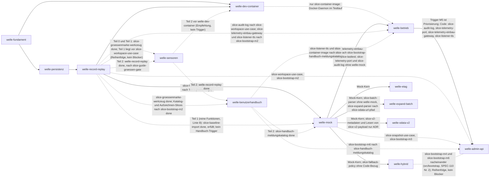

# Roadmap

**Format-Regel:** Die Roadmap ist eine Reihenfolge von **Wellen**,
keine Reihenfolge von Terminen (siehe
Baseline-Regelwerk `modul-06-roadmap.md`).
Termine werden — falls überhaupt — als Konsequenz der Wellen-Schätzung
gezeigt, nicht als Treiber.

---

## Offene Wellen

Regeln dieser Sektion: Baseline-Regelwerk `modul-06-roadmap.md`
§Roadmap-Struktur: fünf Abschnitte — *Offene Wellen* ist **derivativ**: Der
Zustand sind die flachen Welle-Dateien; woran gearbeitet wird, sagt das
`Welle:`-Feld der Slices in `in-progress/`. Ziel, Trigger und
Closure-Kriterien stehen in der Welle-Datei, nicht hier.

- [welle-record-replay](../welle-record-replay.md)
- [welle-mock](../welle-mock.md) (gestaffelt: Trigger von Teil 1, den reinen Funktionen, eingetreten durch [slice-baseline-import](../done/slice-baseline-import.md); Teil 2 wartet auf `welle-record-replay` und `slice-handbuch-meldungskatalog`; gestartet: `slice-odata-url-pfad`, Linie B)
- [welle-benutzerhandbuch](../welle-benutzerhandbuch.md) (gestartet: `slice-handbuch-geruest`, Zweig `slice-handbuch-geruest`; Katalog-, Aufzeichnen- und Abnahme-Slice warten auf `slice-bootstrap-m2`)

**Lesart:** Eine Welle steht hier, wenn ihr Trigger eingetreten ist oder ihr erster Slice gestartet ist; sonst steht sie unter *Nächste Wellen* mit Link auf ihre Datei. Bei einer Welle mit gestaffeltem Start (`welle-sensoren`, `welle-mock`) zählt der Trigger ihres ersten Teils. Ein einzelner Slice, der vor dem Trigger seiner Welle starten darf, weil kein Code der Vorgänger-Welle fehlt, ist eine Ausnahme je Slice (Zusatz in der Welle-Datei, Spalte *Trigger* unten) und verschiebt die Welle nicht; so steht `welle-betrieb` unter *Nächste Wellen*, obwohl `slice-telemetry-port` (Linie D) läuft. `welle-benutzerhandbuch` steht hier, weil mit dem Gerüst ihr erster Slice läuft: Der Trigger der Welle (Werkzeug für die Marke) ist für diesen Zweck erfüllt, weil das Werkzeug in `main` lauffähig ist.

## Nächste Wellen

Regeln dieser Sektion: Baseline-Regelwerk `modul-06-roadmap.md`
§Roadmap-Struktur: fünf Abschnitte, Bullet *Nächste Wellen* — die geordnete
Vorschau: je Zeile Welle, Trigger als beobachtbare Bedingung, wichtigste Slices
und geschätzter Aufwand (S/M/L, kein Termin).

| Welle | Trigger | Wichtigste Slices | Geschätzter Aufwand |
|---|---|---|---|
| [welle-sensoren](../welle-sensoren.md) | Teil 0 und Teil 1: `slice-groessenmarke-werkzeug` (Welle record-replay) liegt in `done/`; Teil 2: `welle-record-replay` und `slice-guide-groessen-gate` liegen in `done/` | Teil 0, nicht-produktiv, blockiert nichts: Gates im Parallelbetrieb mehrerer Arbeitsbäume (Image-Tags je Arbeitsbaum, Sperre, Stempel-Regel); Teil 1, vor `slice-workspace-use-case`: Prüfung auf unsichtbare Zeichen, Größe der Guide-Dateien als Gate (d-check-Modul `file`); Teil 2: Abdeckungs-Deklaration über den Tests mit erzeugten Tabellen, Schwelle der Anweisungsabdeckung | M (Teil 0: S; Teil 1: 2 × S; Teil 2: M, mit Backfill L) |
| [welle-dev-container](../welle-dev-container.md) | `welle-fundament` und `welle-record-replay` liegen in `done/` (M2 erreicht) | Arbeitscontainer mit eigenem Docker-Daemon und Limits, SSH-Zugang, Einlieferung per Zweig, `make gates` und `make gegenproben` im Container, Dokument für Entwickler | M |
| [welle-hybrid](../welle-hybrid.md) | welle-mock done (M3 erreicht); Ausnahme je Slice: `slice-fallback-policy` hat keinen Code-Bezug zu `welle-mock`, ein Start davor ist offen (Entscheidung des Users, Umplanung hier) | Fallback-Policy, `HybridUseCase`, Modus `hybrid` im Composition Root | M |
| [welle-betrieb](../welle-betrieb.md) | welle-mock done (M3 erreicht); `slice-container-image` zusätzlich nach `welle-dev-container` in `done/`. Ausnahmen je Slice, ohne `welle-mock`: `slice-telemetry-port` (in [done/](../done/slice-telemetry-port.md)), `slice-audit-log` (nach `slice-workspace-use-case`), ab M2 `slice-telemetry-einbau-gateway`, `slice-listener-tls`, `slice-container-image` | Port `Telemetry` und Einbau in alle Pfade, `AuditLog`, TLS des Listeners, Container-Image mit Neustarttest, Lasttest zu `LH-QA-01` (Zielwert: Entscheidung des Users offen, Frist vor `slice-lasttest`) | L |
| [welle-admin-api](../welle-admin-api.md) | welle-betrieb done (M5 erreicht; Priorisierung, keine Code-Abhängigkeit). Code-Kanten nach `welle-betrieb`: `slice-audit-log`, `slice-telemetry-port`, `slice-telemetry-einbau-gateway`, `slice-listener-tls`; `slice-inspection-use-case` braucht nur `slice-telemetry-port` | `InspectionUseCase`, Admin-Listener mit Token und Transportschutz, Endpunkte für Sessions, Imports, Workspaces und Snapshots, Sicherheitsnachweis | L |
| [welle-etag](../welle-etag.md) | welle-mock done (M3 erreicht); keine Ausnahme je Slice | ETag, `If-Match` mit `412`, `Prefer` (Soll) | S |
| [welle-expand-batch](../welle-expand-batch.md) | welle-mock done (M3 erreicht). Ausnahmen je Slice: `slice-batch-parser` ohne `welle-mock`, `slice-expand-parser` nach `slice-odata-url-pfad`; `slice-expand-ausfuehrung` zusätzlich nach der Entscheidung des Architect zur Datenbasis | `$expand`, `$batch` mit atomaren Changesets (Soll) | M |
| [welle-odata-v2](../welle-odata-v2.md) | welle-mock done (M3 erreicht), ADR zum versionierten Adapter `Accepted`. Ausnahme je Slice: `slice-v2-metadaten` und das Lesen von `slice-v2-payload` brauchen nur die ADR und den V2-Umfang | Metadaten, Payload und Query für V2, Wahl des Adapters je Service (Kann); offene Frage: Import je Version | L |

## Meilensteine

Regeln dieser Sektion: Baseline-Regelwerk `modul-06-roadmap.md`
§Welle ≠ Meilenstein ≠ Release.

| Meilenstein | Welle(n) | Trigger | Status |
|---|---|---|---|
| M1 | welle-fundament | `make gates` fährt Build, Test, Lint und `a-check` auf Go-Code, jedes durch eine Gegenprobe belegt | erreicht — [slice-gegenproben-build-test](../done/slice-gegenproben-build-test.md) |
| M2 | welle-record-replay | Ein Test zeichnet gegen einen Referenzdienst auf und spielt ohne Upstream wieder ab | offen |
| M3 | welle-mock | Ein Test beantwortet aus einer importierten Baseline `$metadata` und Abfragen mit Optionen, ändert und löscht Entities mit sichtbaren Zustandsübergängen, stellt einen Snapshot wieder her und setzt zurück, ohne Upstream | offen |
| M4 | welle-hybrid | Ein Test belegt am Verbindungszähler eines Referenzdienstes, dass im Modus `hybrid` nur freigegebene lesende Anfragen den Upstream erreichen und ein POST ohne Freigabe nie | offen |
| M5 | welle-betrieb | Der Lasttest nach `LH-QA-01.a` läuft reproduzierbar und weist p95 aus dem Gesamtspan für Replay und Mock aus | offen |
| M6 | welle-admin-api | Ein Test steuert Aufzeichnung, Import, Workspace, Snapshot und Reset ausschließlich über den Admin-Listener mit Token und weist Anfragen ohne Token ab | offen |
| M7 | welle-record-replay, welle-mock, welle-hybrid, welle-betrieb, welle-admin-api, welle-dev-container | Erstabnahme: alle Muss-Anforderungen des Lastenhefts haben einen Beleg, der fachliche Owner hat den Zielwert von `LH-QA-01` bestätigt, und das Lastenheft trägt den Status `Accepted` | offen; Zielwert `LH-QA-01` ungeklärt, Adresse: User, Frist vor Start von `slice-lasttest` ([Bericht](../../../reviews/2026-10-30-lastenheft-wellen-abgleich.md) §10 Nr. 8) |

## Abhängigkeitsgraph

Regeln dieser Sektion: Baseline-Regelwerk `modul-06-roadmap.md`
§Roadmap-Struktur: fünf Abschnitte, Bullet *Nächste Wellen* — die Abhängigkeit
steht als beobachtbare Bedingung in der `Trigger`-Spalte **und** als gerichtete
Kante hier; eine Welle, die ohne fertige Vorgängerin nicht starten kann, ist
eine Phantom-Welle.

## Abgeschlossene Wellen

Regeln dieser Sektion: Baseline-Regelwerk `modul-06-roadmap.md`
§Roadmap-Struktur: fünf Abschnitte.

| Welle | Abschluss | Closure-Notiz |
|---|---|---|
| welle-fundament | 2026-10-19 | [welle-fundament-results](../done/welle-fundament-results.md) |
| welle-persistenz | 2026-10-20 | [welle-persistenz-results](../done/welle-persistenz-results.md) |

## Historische Trigger-Verschiebungen

Regeln dieser Sektion: Baseline-Regelwerk `modul-06-roadmap.md`
§Roadmap-Struktur: fünf Abschnitte, Bullet *Historische Trigger-Verschiebungen*
— das Drift-Log: jede Umplanung mit Datum, Änderung, Grund. Leer heißt starre
Roadmap, jede Zeile voll heißt treibende.

| Datum | Was wurde geändert? | Warum? |
|---|---|---|
| 2026-10-21 | [welle-record-replay](../welle-record-replay.md): [slice-record-service](../done/slice-record-service.md) vor dem ersten Code-Commit geschnitten; der Adapter `httpupstream` ist [slice-upstream-adapter](../done/slice-upstream-adapter.md), nach `slice-record-service` und vor `slice-bootstrap-m2`; die Welle führt 15 Slices statt 14 | Schätzung rund 4700 Zeilen und drei Schichten (Outbound Port, Dienst, Driven Adapter) in einem Slice; ein Schnitt vor dem Code statt einer Rückführung danach, die bei zehn Überschreitungen keinmal genommen wurde (`BEO-REPO/groessenmarke-ueberschritten-ohne-rueckfuehrung`) |
| 2026-10-21 | [welle-record-replay](../welle-record-replay.md): [slice-upstream-adapter](../done/slice-upstream-adapter.md) beim Handoff geschnitten; die TLS-Konfiguration des Adapters (`CAPEM`, `Pruefen`, HTTP/1.1 über TLS) ist [slice-upstream-tls](../done/slice-upstream-tls.md), nach `slice-upstream-adapter` und vor `slice-bootstrap-m2`; die Welle führt 16 Slices statt 15 | Handoff 2831 Zeilen über der Schwelle 2500 aus §4 des Plans; ohne Schnitt hielte die Marke 2900 nur bei höchstens 69 Zeilen Zuwachs im Review, gemessen waren in den Vorgängern 12,3 und 16,1 %; der Schnitt war vorab benannt und durch die Auflage (TLS-Teil zuletzt, in eigenem Commit) nach dem Code nehmbar |
| 2026-10-21 | [welle-record-replay](../welle-record-replay.md): [slice-race-gate](../done/slice-race-gate.md) neu, vor `slice-http-adapter`, dessen Start ihn in `done/` verlangt; [slice-protokolltreue](../open/slice-protokolltreue.md) neu, nach `slice-bootstrap-m2` als letzter Slice; die Welle führt 18 Slices statt 16 | Entscheidung des Users zu den Beobachtungen über der Schwelle: `BEO-REPO/nebenlaeufiger-lauf-nur-im-glueck-gruen` (5×) bekommt den Ausgang `geplant` mit einem Race-Detektor im Gate; der Vergleichstest der Messmethode von `LH-QA-07` hatte in der Welle keinen Träger, und `slice-bootstrap-m2` bleibt beim Satz von M2 |
| 2026-10-23 | [welle-record-replay](../welle-record-replay.md): [slice-session-wartung](../done/slice-session-wartung.md) beim Start vor dem ersten Code-Commit geschnitten; `SessionUseCase` ist [slice-session-use-case](../done/slice-session-use-case.md), nach `slice-session-wartung` (`MaintenanceUseCase`) und vor `slice-baseline-import` und `slice-bootstrap-m2`; die Welle führt 19 Slices statt 18 | Schätzung beider Use Cases in einem Slice rund 3250 bis 3750 Zeilen (Tabelle × 85 bzw. 40, plus Port-Fakes, × 1,25), über der Grenze 3000 aus `AGENTS.md` §3.14; ein Schnitt vor dem Code statt einer Rückführung danach (`BEO-REPO/groessenmarke-ueberschritten-ohne-rueckfuehrung`); gemeinsam ist nur der Port der Bereinigung |
| 2026-10-23 | [welle-record-replay](../welle-record-replay.md): [slice-session-use-case](../done/slice-session-use-case.md) beim Start vor dem ersten Code-Commit geschnitten; das Beenden (`Drain`, Statusregel, `CloseAll`) ist [slice-session-beenden](../done/slice-session-beenden.md), nach `slice-session-use-case` und vor `slice-bootstrap-m2`; die Welle führt 20 Slices statt 19 | Schätzung beider Teile in einem Slice rund 3300 Zeilen (30 Zeilen der Tabelle, 9 nebenläufig, 5 Port-Fakes, × 1,25), über der Grenze 3000 aus `AGENTS.md` §3.14; ein Schnitt vor dem Code statt einer Rückführung danach; gemeinsam sind Konstruktor, Konfig, Fehlerabbildung und die Fakes des Pakets |
| 2026-10-25 | [welle-record-replay](../welle-record-replay.md): [slice-groessenmarke-werkzeug](../done/slice-groessenmarke-werkzeug.md) neu, nach `slice-baseline-import` und vor `slice-workspace-use-case`; die Welle führt 21 Slices statt 20 | Entscheidung des Users zu `BEO-REPO/groessenmarke-ueberschritten-ohne-rueckfuehrung` (16×): Ausgang `geplant` mit einem Werkzeug statt einer Prosa-Regel, denn die Formel der Platte verfehlt zwei von drei Messpunkten; das Werkzeug soll vor der nächsten Marke (`slice-workspace-use-case`) liegen; die Einordnung in die Welle ist vom User bestätigt |
| 2026-10-30 | Reihenfolge der Wellen: [welle-sensoren](../welle-sensoren.md) startet gestaffelt, Teil 1 (`slice-unsichtbare-zeichen`, `slice-guide-groessen-gate`) nach `slice-groessenmarke-werkzeug` und vor `slice-workspace-use-case` (Reihenfolge, kein Blocker), Teil 2 (`slice-abdeckung-deklaration`, `slice-coverage-gate`) nach `welle-record-replay`; [welle-dev-container](../welle-dev-container.md) startet nach `welle-record-replay` (Trigger vorher nur `welle-fundament`), Kante zu `slice-container-image` von [welle-betrieb](../welle-betrieb.md); `slice-handbuch-geruest` nach Teil 1; `slice-cli-kommandos` entfällt, [welle-admin-api](../welle-admin-api.md) führt 8 Slices statt 9 | Teil 1 schützt jede Datei, die die folgenden Slices schreiben, und friert die Größe der Guide-Dateien ein, ohne `src/` zu berühren; Teil 2 (Backfill über 618 Testfunktionen in 105 Dateien, Schwelle gegen den Code von M2) kollidiert mit den Dateien, die die Slices von M2 schreiben; der Arbeitscontainer fährt eine Gate-Kette, die nach M2 stabil ist, und der Neustarttest von `slice-container-image` braucht dessen Docker-Daemon; kein Anker im Lastenheft für Kommandos über Start und Version hinaus (`LH-FA-13` verlangt eine Verwaltungsschnittstelle). Entscheidungen des Users zum Abgleich [Lastenheft gegen Wellen](../../../reviews/2026-10-30-lastenheft-wellen-abgleich.md) |
| 2026-10-30 | [welle-mock](../welle-mock.md) startet gestaffelt: Teil 1 (`slice-odata-url-pfad`, `slice-odata-url-filter`, `slice-edm-ausdruecke`, `slice-query-interpreter`, `slice-odata-json-schreiben`, `slice-odata-json-eingabe`) mit dem Trigger `slice-baseline-import` in `done/` (erfüllt), die Welle steht unter *Offene Wellen*; Teil 2 (`slice-mock-lesen`, `slice-mock-schreiben`, `slice-snapshot-use-case`, `slice-mock-abnahme`, `slice-bootstrap-m3`) behält den Trigger (`welle-record-replay` und `slice-handbuch-meldungskatalog` in `done/`); Parallelbetrieb produktiver Slices in Worktrees mit [Übergangsregeln](../README.md#parallelbetrieb-in-worktrees-übergangsregeln) (Sperre für schwere Läufe, Stempel im Integrationsschritt, Kennungsbereiche je Linie); [slice-worktree-parallel](../open/slice-worktree-parallel.md) neu als Teil 0 von [welle-sensoren](../welle-sensoren.md), nicht-produktiv, blockiert nichts; die Welle führt 5 Slices statt 4 | Entscheidung des Users: produktive Slices und Wellen sollen jetzt parallel in Worktrees laufen, der Werkzeug-Slice darf sie nicht blockieren. Die sechs Slices von Teil 1 sind reine Funktionen und Codecs auf Modell und Codec zum Lesen, ohne Port-Anbindung und ohne sichtbares Verhalten am Binary; sie brauchen weder `welle-record-replay` noch das Handbuch-Gerüst. Die Antwort des Users auf Frage 7 des Abgleichs („frühestens nach `welle-dev-container`“) ist damit durch die Übergangsregeln ersetzt |
| 2026-10-30 | Start-Trigger je Slice statt je Welle: die Slice-Pläne von [welle-hybrid](../welle-hybrid.md), [welle-betrieb](../welle-betrieb.md), [welle-admin-api](../welle-admin-api.md), [welle-etag](../welle-etag.md), [welle-expand-batch](../welle-expand-batch.md) und [welle-odata-v2](../welle-odata-v2.md) liegen in `open/` und tragen ihre Abhängigkeiten; Wellen-Trigger bleiben formal, Ausnahmen je Slice stehen in den Welle-Dateien (§2). Gestartet vor dem Welle-Trigger: `slice-telemetry-port` (Linie D, Kennungsbereich in den [Übergangsregeln](../README.md#parallelbetrieb-in-worktrees-übergangsregeln)); `slice-handbuch-geruest` vor Teil 1 von [welle-sensoren](../welle-sensoren.md) und vor `slice-groessenmarke-werkzeug` in `done/`, [welle-benutzerhandbuch](../welle-benutzerhandbuch.md) steht damit unter *Offene Wellen*; `slice-workspace-use-case` (Linie A) vor der Closure des Werkzeug-Slice. `welle-betrieb` bleibt unter *Nächste Wellen* | Entscheidung des Users: Slice-Pläne aller Produkt-Wellen jetzt anlegen, Abhängigkeiten in den Plänen führen und freie Linien in eigenen Worktrees starten. Die Pläne zeigen Slices ohne Code-Bezug zum Trigger ihrer Welle (`slice-telemetry-port`, `slice-audit-log`, `slice-batch-parser`, `slice-v2-metadaten`, `slice-fallback-policy`); der Start von `slice-telemetry-port` ist eine Ausnahme je Slice und nicht der Start der Welle, deren Closure (Spans von Mock und Workspace, Lasttest) `welle-mock` voraussetzt |
