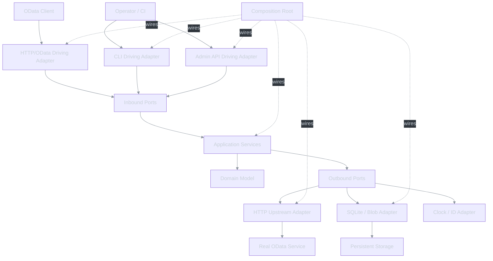
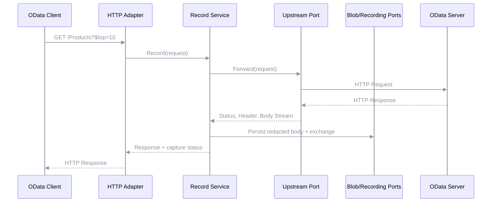
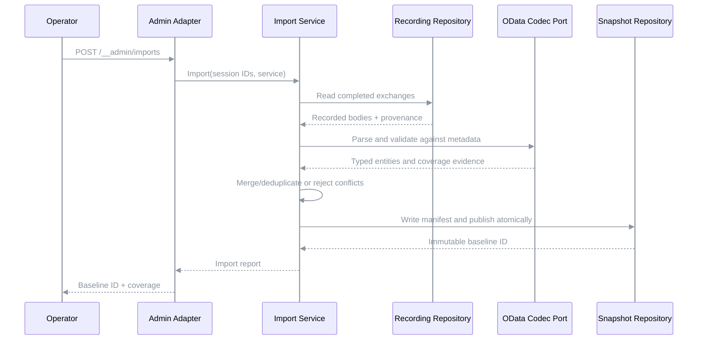
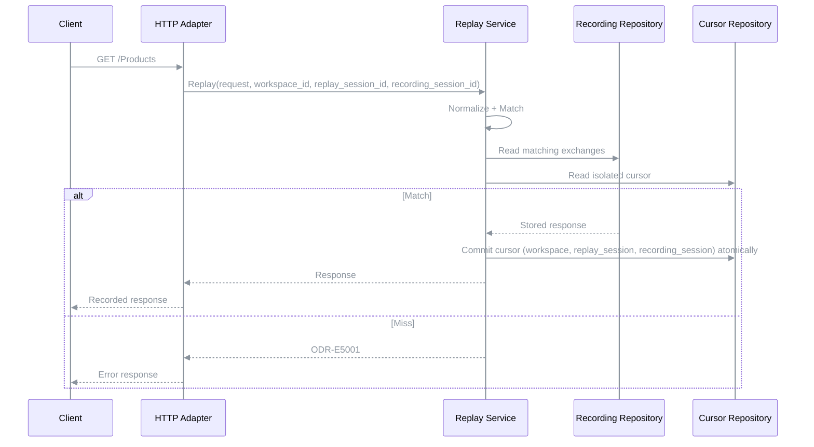
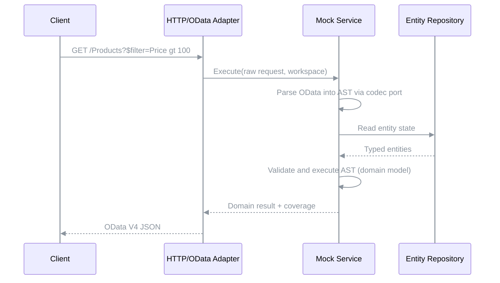
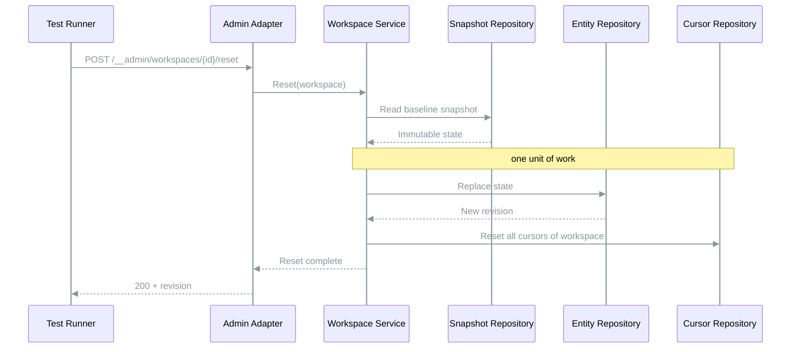
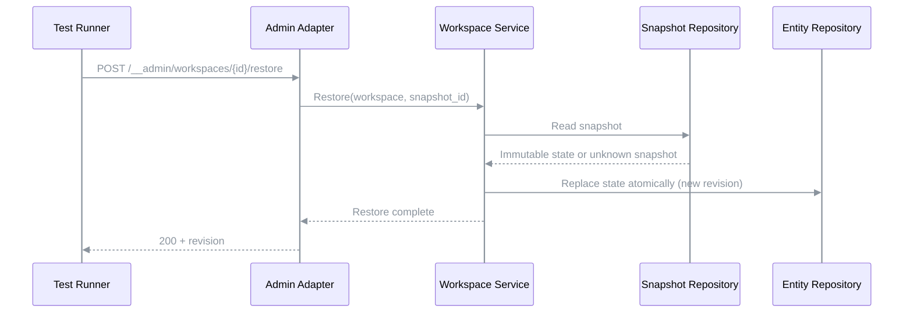
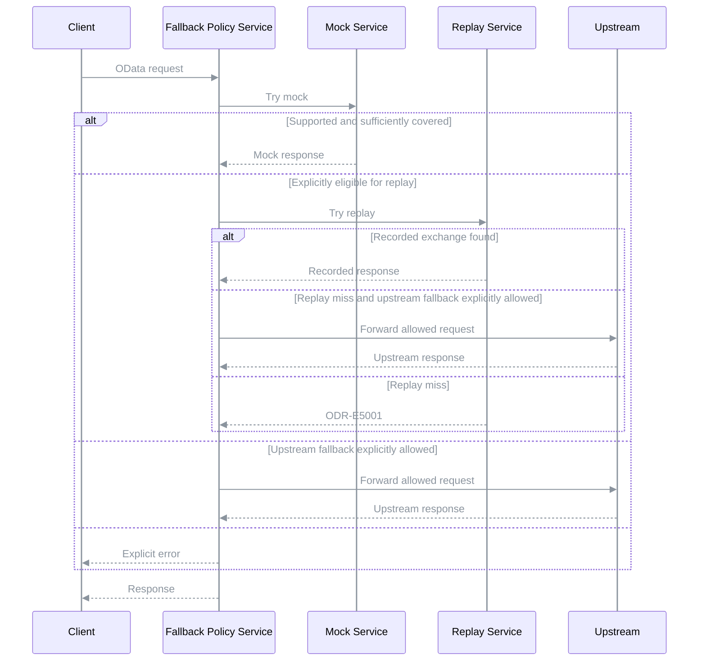
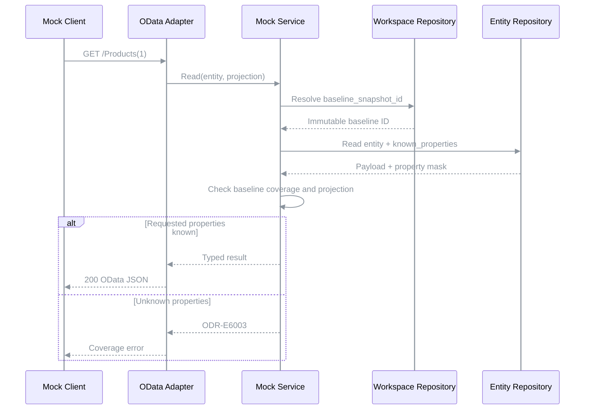
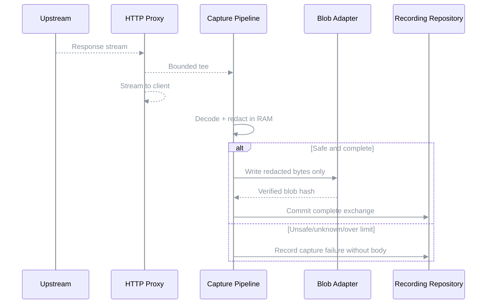

# Architektur — OData Recorder

**Status:** Draft · **Letzte Änderung:** 2026-10-18

**Rolle:** Derivative Architektur-Sicht gemäß `ai-harness-course`: keine neuen Anforderungen, keine Meilensteine, keine Historie, keine ADR-Bezüge. **Bezug:** `spec/lastenheft.md`, `spec/spezifikation.md`.

**Architekturstil:** Hexagonale Architektur (Ports & Adapters), modularer Monolith. Die Struktur ergänzt Aufzeichnung und Wiedergabe um OData-Metadaten, Query-Auswertung und zustandsbehaftete Workspaces. Die hier dargestellten Ports sind konzeptionelle Verträge, keine bereits implementierten APIs.

---

## 1. Komponenten-Übersicht

**Abhängigkeitsrichtung:**

```text
Driving Actor → Driving Adapter → Inbound Port ← Application Service
Application Service → Domain Model
Application Service → Outbound Port ← Driven Adapter → Driven Actor
Composition Root verdrahtet konkrete Implementierungen.
```

Der Application Core kennt weder HTTP-Server- oder -Client-Bibliotheken, SQLite-Treiber, OData-XML-/JSON-Bibliotheken, Dateisystem noch CLI-Frameworks. Die Transport- und Persistenztechnologie bleibt an den Adaptern.



| ID | Komponente | Rolle |
|---|---|---|
| `ARC-001` | Domain Model (`internal/hexagon/model`) | Session, Exchange, Request, Response, OData Service Model, Query AST, Entity, Workspace, Snapshot, Coverage, fachliche Invarianten |
| `ARC-002` | Application Services (`internal/hexagon/services`) | Record, Replay, Mock, **Baseline-Import**, Workspace, Snapshot, Coverage, Fallback-Policy; Use-Case-Orchestrierung |
| `ARC-003` | Inbound Ports (`internal/hexagon/ports/inbound`) | Anwendungsfälle für Request-Verarbeitung, Recording, Replay, Mock und Administration |
| `ARC-004` | Outbound Ports (`internal/hexagon/ports/outbound`) | Upstream HTTP, RecordingRepository, BlobRepository, CursorRepository, WorkspaceRepository, EntityRepository, SnapshotRepository, MetadataRepository, CoverageRepository, ImportRepository, ODataCodec, Uhr, ID-Quelle |
| `ARC-005` | HTTP/OData Driving Adapter (`internal/adapters/driving/httpodata`) | HTTP-Eingang, Header-/Body-Streaming, Mapping von Request und Response auf Domain-DTOs; OData-Parsing und -Serialisierung laufen über den Codec-Port im Core |
| `ARC-006` | CLI Driving Adapter (`internal/adapters/driving/cli`) | Konfiguration, Kommandoauswahl, Start-/Exit-Verhalten |
| `ARC-007` | Admin API Driving Adapter (`internal/adapters/driving/admin`) | Workspaces, Snapshots, Sessions, Coverage, Diagnose |
| `ARC-008` | HTTP Upstream Driven Adapter (`internal/adapters/driven/httpupstream`) | HTTP/TLS-Verbindung zum echten OData-Service |
| `ARC-009` | Recording/State Driven Adapter (`internal/adapters/driven/sqlite`) | Transaktionale Speicherung und Abfrage der Records und Workspace-Daten |
| `ARC-010` | Blob Driven Adapter (`internal/adapters/driven/blobs`) | Bytegetreue, content-adressierte Body-Ablage und Integritätsprüfung |
| `ARC-011` | OData Codec Driven Adapter (`internal/adapters/driven/odata`) | Implementiert den Port `ODataCodec`: CSDL-Parsing, OData-URL-Parsing, JSON-Serialisierung, externe Protokollrepräsentation |
| `ARC-012` | Bootstrap / Composition Root (`cmd/odata-recorder`, `internal/bootstrap`) | Verdrahtung aller Ports, Services und Adapter; Lifecycle |

**Baseline-Import:** `ImportUseCase` in `ARC-002` liest Exchanges über `RecordingRepository`, interpretiert OData-V4-JSON über den Port `ODataCodec` (`ARC-011`), validiert Schlüssel und Typen gegen `MetadataRepository`, schreibt ein unveränderliches Snapshot-Manifest über `SnapshotRepository`/`BlobRepository`, führt Import-Eintrag und Baseline-Quellen über `ImportRepository` und veröffentlicht die Baseline atomar. Kein HTTP-Adapter und kein SQLite-Adapter entscheidet selbst über Deduplizierung oder Coverage.

**Abgrenzung:** Die OData-Query-Semantik (Filter, Sortierung, Paging, Typregeln) gehört zum Core; das Parsen konkreter HTTP-/CSDL-/JSON-Darstellungen liegt im Codec-Adapter. Der Core verwendet einen technologieunabhängigen AST.

**Codec-Zugriff:** Kein Driving Adapter ruft den Codec auf und importiert `adapters/driven/odata`. Der HTTP-Adapter reicht Methode, Pfad, `raw_query`, Header und Body-Strom unverändert als Domain-DTO an einen Inbound Port; Parsen und Serialisieren geschieht im Application Service über den Outbound Port `ODataCodec`. Die konkrete Implementierung verdrahtet allein `internal/bootstrap` (Composition Root). Damit bleibt der Importgraph auf die erlaubten Kanten beschränkt, und der Codec lässt sich im Test durch einen Fake ersetzen.

---

## 2. Schichten und Constraints

| Komponente(n) | Schicht | Verantwortlichkeit | Darf importieren | Darf NICHT importieren |
|---|---|---|---|---|
| `ARC-001` | Domain | Fachliche Werte, Invarianten, AST | Standardbibliothek ohne I/O | Services, Ports, Adapter, SQL/HTTP-Bibliotheken |
| `ARC-003`, `ARC-004` | Ports | Fachliche Schnittstellen | Domain | Adapter, CLI, SQLite, HTTP-Server |
| `ARC-002` | Application | Use Cases, State- und Matching-Logik | Domain, Outbound Ports | Driving Adapter, SQLite, konkrete HTTP-Clients |
| `ARC-005`–`ARC-007` | Driving Adapters | Transport- und Bedienoberfläche | Inbound Ports, Domain | Driven Adapter, andere Driving Adapter, Application Services |
| `ARC-008`–`ARC-011` | Driven Adapters (einschließlich Codec) | Upstream, Persistenz, Serialisierung | Domain, passende Outbound Ports | Driving Adapter, Application Services |
| `ARC-012` | Composition Root | Dependency Injection, Konfiguration, Lifecycle | alle | — |

**Zusätzliche Hard Rules:**

- Der Core verwendet in öffentlichen fachlichen Port-Signaturen keinen Typ einer Datenbank- oder HTTP-Bibliothek.
- HTTP-Header und Bodies werden am Adapter-Rand in kanonische Domain-DTOs abgebildet; Rohbytes dürfen als Byte-Folgen oder Streams über explizite Ports weitergegeben werden.
- SQLite-SQL und Migrationen liegen ausschließlich in `ARC-009`; Dateisystemzugriffe für Blobs in `ARC-010`.
- Die OData-Parserbibliothek ist nur in `ARC-011` erlaubt. Ein AST-Typ im Domain Model darf keine Parserbibliothek referenzieren.
- Adapter importieren einander nicht. Gemeinsame Funktionen gehören in Domain/Ports oder in ein adapterneutrales Hilfspaket.
- Kein inneres Package beendet den Prozess; Signalbehandlung liegt in CLI/Bootstrap.
- Die Admin API ist von der OData-Service-API getrennt und darf keine fachlichen Mock-Abkürzungen direkt in die Datenbank schreiben.

### 2.1 Package-Struktur

```text
cmd/
└── odata-recorder/
    └── main.go
internal/
├── hexagon/
│   ├── model/
│   │   ├── recording/
│   │   ├── odata/
│   │   ├── workspace/
│   │   └── errors/
│   ├── ports/
│   │   ├── inbound/
│   │   └── outbound/
│   └── services/
│       ├── record/
│       ├── replay/
│       ├── mock/
│       ├── coverage/
│       ├── baselineimport/
│       ├── session/
│       ├── snapshot/
│       └── workspace/
├── adapters/
│   ├── driving/
│   │   ├── httpodata/
│   │   ├── admin/
│   │   └── cli/
│   └── driven/
│       ├── httpupstream/
│       ├── sqlite/
│       ├── blobs/
│       ├── clock/
│       └── odata/
│           ├── csdl/
│           ├── urlparser/
│           └── jsoncodec/
└── bootstrap/
migrations/
tests/
├── contract/
└── integration/
```

### 2.2 Inbound Ports

| Port | Aufgabe | Rückgabe |
|---|---|---|
| `ImportUseCase` | Aufgezeichnete Entities explizit in eine neue Mock-Baseline überführen; Import-Report und Provenienz lesen; Wiederholung mit gleicher `import_id` idempotent behandeln | Snapshot-ID, Import-Report, Coverage-Evidenz |
| `RecordUseCase` | HTTP-Austausch an Upstream weiterleiten und erfassen | Response, Capture-Status |
| `ReplayUseCase` | Recording zu explizitem Workspace, Recording-Session und Replay-Session matchen | aufgezeichnete Response oder Mismatch |
| `MockUseCase` | OData-Request auf Workspace-State ausführen | OData-Response |
| `WorkspaceUseCase` | Workspace erstellen, auflisten, lesen, löschen, resetten, mutieren | Workspace-Revision bzw. Verwaltungsdaten |
| `SnapshotUseCase` | Snapshot erzeugen, auflisten, wiederherstellen | Snapshot-ID bzw. neue Revision |
| `SessionUseCase` | Sessions auflisten, lesen, löschen; Aufbewahrung beim Start anwenden | Verwaltungsdaten bzw. Löschbericht |
| `InspectionUseCase` | Exchanges, Coverage und Diagnose lesen | paginierte Verwaltungsdaten |

Der HTTP-Adapter entscheidet **nicht** über Replay-Cursor, Match-Key, Coverage oder CRUD-Semantik. Der Core entscheidet **nicht** über TLS, Socket-Lifecycle oder HTTP-Chunking.

### 2.3 Outbound Ports

| Port | Verantwortung |
|---|---|
| `UpstreamClient` | HTTP-Request an erlaubten Zielservice senden; Response streamen |
| `RecordingRepository` | Exchanges append-only persistieren und lesen; ganze Sessions auflisten und löschen |
| `BlobRepository` | Bodies sicher ablegen/lesen, Hash prüfen |
| `MetadataRepository` | Service-Metadaten und Versionen verwalten |
| `WorkspaceRepository` | Workspaces mit Revision und Baseline-Bezug persistieren, auflisten und löschen |
| `EntityRepository` | Transaktionale Entity-Reads und -Writes pro Workspace |
| `SnapshotRepository` | Unveränderliche Snapshots, versionierte Manifeste und Restore |
| `CoverageRepository` | Coverage-Status mit Evidenz je Baseline speichern |
| `ImportRepository` | Import-Einträge (`import_id`, Anfrage-Hash, Report) und die Baseline-Quellen einer Baseline in der Transaktion der Baseline schreiben und lesen |
| `CursorRepository` | Veränderlichen Replay-Cursor-Zustand je `(workspace, replay_session, recording_session)` atomar lesen und fortschreiben; getrennt vom append-only `RecordingRepository` |
| `ODataCodec` | CSDL-, OData-URL- und OData-JSON-Darstellung in Domain-Modell und AST überführen und zurück |
| `Clock` / `IDGenerator` | Deterministische Zeit und IDs in Tests |

**Streaming-Port-Lifecycle:** Der HTTP-Adapter besitzt Request-/Response-Streams und schließt sie. Der Record-Service erhält kontextgebundene Stream-Handles; `CaptureWriter` erlaubt `Write` und genau einen Abschluss (`Commit` oder `Abort`). Ein Capture-Fehler nach Beginn der Response-Ausgabe darf den HTTP-Status nicht rückwirkend verändern. Backpressure und Body-Limit führen zum Abbruch der Aufzeichnung, nicht zu unbeschränktem Puffern. Redigierte Bodies sind als eingeschränkt replayfähig gekennzeichnet.

**Replay-Zuordnung:** Die Zuordnung wird an der HTTP-Grenze entgegengenommen und im Replay-Service gegen die Spezifikation validiert (`LH-FA-04.b`, `SPEC-052`). Der Cursor gehört zum Tupel `(workspace, replay_session, recording_session)` und liegt hinter `CursorRepository`.

**Reset vs. Restore:** Die Wirkung auf Entity-State und Cursor legen `LH-FA-09` und `LH-FA-10` fest; Reset greift auf `EntityRepository` und `CursorRepository` zu, Restore nur auf `EntityRepository`.

**Port-Design:** Die Transaktionsgrenze ist fachlich (`WithWorkspaceTransaction` oder äquivalentes Unit-of-Work-Konzept), nicht als offene SQL-Connection exponiert. Reset (Entity-State und Cursor) und Löschen eines Workspace laufen in einer solchen Transaktion über `WorkspaceRepository`, `EntityRepository`, `CursorRepository` und `SnapshotRepository`. Für große Bodies existiert ein Streaming-Port mit begrenztem Puffer und explizitem Abschluss.

### 2.4 Fachliche Zustände

**Recording:** `OPEN → CAPTURING → COMPLETE`, bei Abbruch `INCOMPLETE` oder `FAILED`. Nur `COMPLETE`-Exchanges sind regulär replayfähig.

**Replay:** `UNASSIGNED → READY → MATCHING → RESPONDING → READY`. Ein Mismatch, ein nicht replayfähiger Treffer und ein Strict-Mismatch beenden die Anfrage mit einem Fehler und lassen den Cursor unverändert in `READY`. `EXHAUSTED` gilt je Match-Key (im Modus `strict` am Ende der Folge) und sperrt weitere Anfragen mit anderem Key nicht. Der Cursor gehört zur Application Session / zum Workspace, nicht zum HTTP-Adapter.

**Mock:** `READY → VALIDATING → READING|MUTATING → SERIALIZING → READY`. Mutationen werden erst nach erfolgreicher Validierung committed.

**Coverage:** `unknown`, `partial`, `complete`; vor Collection-Reads geprüft; null beobachtete Entities sind kein Leerheitsbeweis; `complete` ist nur nach belegter Vollerfassung zulässig.

### 2.5 Modus-Routing

| Modus | Eingangsweg | Upstream erlaubt? |
|---|---|---|
| `record` | Record Service → Upstream + Recording | Ja, konfiguriert |
| `replay` | Replay Service → Recording | Nein |
| `mock` | Mock Service → Entity State | Nein |
| `hybrid` | Mock; bei explizit erlaubtem `unsupported`/`coverage_insufficient` optional Replay; sonst Fehler | Nur explizit erlaubte Requests (`LH-FA-12.a`) |

Fachliche `404`, `409`, `412` und ungültige Requests lösen keinen Fallback aus. Der Betriebsmodus wird beim Prozessstart festgelegt und nicht über die Admin API gewechselt. Unbekannte Operationen im Mock dürfen nicht in einen unkontrollierten Upstream-Fallback münden. Die Fallback-Policy wird vor dem Senden an den Upstream geprüft.

---

## 3. Externe Abhängigkeiten

| ID | System | Rolle | Substituierbarkeit |
|---|---|---|---|
| `ARC-013` | OData-V4-Server | Externer Driven Actor für Record / erlaubten Hybrid-Fallback | Über `UpstreamClient` fakebar |
| `ARC-014` | SQLite | Persistenz für Sessions, Exchanges, Entity State, Cursor und Coverage | Über Repository-Ports austauschbar |
| `ARC-015` | Dateisystem / OCI Volume | Persistente Blob-Ablage und Datenverzeichnis | Über Blob-Port austauschbar |
| `ARC-016` | HTTP/OData-Client | Driving Actor, der Record/Replay/Mock aufruft | Test-HTTP-Client |
| `ARC-017` | OData V4 / CSDL / HTTP | Externe Protokollverträge für die Adapter | Contract-Test-Suite |
| `ARC-018` | Docker/OCI Runtime | Prozessausführung, Konfiguration, Persistenz-Volumes | Binary auch nativ startbar |

Die Bibliothekswahl ist keine Eigenschaft des Domain Models. Ein Austausch des HTTP-Stacks, SQLite-Treibers oder OData-Parsers darf die fachlichen Use Cases nicht verändern.

---

## 4. Sequenz-Diagramme

### 4.1 LH-FA-01 / LH-FA-02 — Record



Die technische Streaming-Implementierung darf Weitergabe und Persistenz überlappen; das Diagramm beschreibt logische Verantwortlichkeiten, keine vollständige Byte-für-Byte-Zeitordnung.

### 4.2 LH-FA-18 — Recording-Import



### 4.3 LH-FA-04 / LH-FA-05 — Replay



Der Replay-Service besitzt keine Upstream-Abhängigkeit; eine Netzwerkverbindung zum Backend ist in diesem Modus architektonisch ausgeschlossen.

### 4.4 LH-FA-07 / LH-FA-08 — Stateful Mock



### 4.5 LH-FA-09 / LH-FA-10 — Reset und Snapshot



Restore verwendet denselben Weg ohne den Schritt zum `CursorRepository`:



### 4.6 LH-FA-11 / LH-FA-12 — Coverage und Hybrid-Fallback



Fallback ist eine eigene Policy-Entscheidung und kein automatisch erzwungener Teil der Sequenz.

---

### 4.7 LH-FA-11 / LH-FA-18 — Baseline-Provenienz und Property-Masken



Die Coverage ist an die **Baseline-ID** gebunden, nicht an den Service. Die Property-Maske gehört zu jedem gespeicherten Entity-State und zu jedem Snapshot. Lokale Writes ändern die Herkunftsevidenz nicht.

### 4.8 LH-FA-02 / LH-FA-14 — Capture ohne Klartext-Spool



Rohbytes werden **nie** als unredigierte Temp- oder Blob-Dateien geschrieben. Unsichere Capture-Pfade scheitern geschlossen, ohne den laufenden Proxy unnötig zu blockieren. Replay nutzt die Matrix aus `SPEC-045`.

## 5. Fehlermodelle und Resilienz

| Fehlerquelle | Behandlungsschicht | Verhalten / Logging |
|---|---|---|
| Upstream-TLS/Timeout | `ARC-008` → `ARC-002` | Klassifizierter Transportfehler, HTTP 502/504 soweit möglich |
| Replay-Mismatch | `ARC-002` | `ODR-E5001`, Session/Exchange/Match-Strategie |
| Defektes Recording/Blob | `ARC-009`/`ARC-010` | `ODR-E3001`, keine Ersatzdaten |
| Unbekannte OData-Funktion | `ARC-011` → `ARC-002` | Expliziter 501-Pfad |
| Ungenügende Coverage | `ARC-002` | `ODR-E6003`, keine irreführende leere Collection |
| Concurrency-Konflikt | `ARC-002`/`ARC-009` | Atomarer Rollback, 409 oder 412 je Vertragsfall |
| Redaction-Fehler | `ARC-005`/`ARC-002` | Keine unredigierte Ablage; Capture-Fehler |
| Ungültige Admin-Anfrage | `ARC-007` | 400/401/404/409/422, strukturierter Audit-Eintrag |
| Prozess-Signal | `ARC-006`/`ARC-012` | Graceful Shutdown nach `LH-FA-02.c` |

**Concurrency:** Gleichzeitige HTTP-Verbindungen sind zulässig. Replay-Cursor und Workspace-Schreibtransaktionen werden jeweils separat synchronisiert; Tests beeinflussen andere Workspaces nicht. SQLite wird mit kurzer Transaktionsdauer und Busy-Timeout betrieben.

**Import-Konsistenz:** Importiert wird in einen temporären Zustand. Ein Key-Konflikt, eine Metadatenabweichung oder ein defekter Blob verhindert die Publikation der gesamten Baseline. Provenienz und Coverage-Evidenz sind Teil des Manifests.

**Migration und Recovery:** Die initiale SQLite-Migration definiert die FK-Beziehungen einschließlich `workspaces.baseline_snapshot_id`; Recovery prüft DB/FK/Blob-Integrität und unterscheidet verwaiste redigierte Blobs von fehlenden referenzierten Blobs. Die Fault-Injection-Matrix steht in `SPEC-048`.

**Crash-Konsistenz:** SQLite-Commit und Blob-Rename sind nicht eine einzige globale Transaktion. Der Blob wird zuerst sicher geschrieben; erst danach referenziert ihn eine DB-Transaktion. Verwaiste Blobs sind tolerierbar und werden später bereinigt; fehlende referenzierte Blobs sind Integritätsfehler.

**Graceful Shutdown:** Ablauf und Frist legt `LH-FA-02.c` fest; Bootstrap und CLI orchestrieren, die Services finalisieren offene Captures.

**Sicherheit:** Redaction vor Persistenz; Admin-Zugriff nur mit Token (`LH-FA-13.a`), Listener standardmäßig loopback; kein produktiver Auth-Proxy oder generischer Internet-Proxy; TLS-Zertifikate werden geprüft. Im Hybrid-Modus verhindern Allowlists ungewollte Mutationen.

---

**Mock-Integrität:** Coverage wird je unveränderlicher Baseline gespeichert; der Workspace verweist per Fremdschlüssel auf seine Baseline. Partielle Entity-Projektionen tragen eine Property-Maske. Unbekannte Werte sind nicht gleich `null`; partielle Entity-Updates werden entsprechend `SPEC-044` beschränkt.

## 6. Qualitätssicherung der Architektur

- **Import-Tests:** Paginierte Teilmengen, Duplikate, widersprüchliche Keys, Projektionen, Provenienz und atomarer Rollback.
- **Domain-Tests:** Query AST, Schlüsselkanonisierung, Entity-Validierung, Coverage-Invarianten, Snapshot-Revisionsmodell; ohne Netzwerk und Datenbank.
- **Application-Tests:** Fake-Ports für Record/Replay/Mock, deterministische Uhr und IDs; Sequenz-Matching und Reset ohne Adapter.
- **Adapter-Contract-Tests:** HTTP Header/Body, CSDL, OData-V4-JSON, SQLite-Migrationen, Blob-Roundtrip, Fehlerzuordnung.
- **Contract-Matrix:** Decimal, Date, DateTimeOffset, Int64, null, Composite Keys, `@odata.context`, `@odata.count`, `Location`, CRUD-Statuscodes; `Prefer` als Soll.
- **End-to-End:** Test-OData-Server starten → Requests aufzeichnen → Server stoppen → Replay; danach Mock CRUD, Filter, Snapshot und Reset.
- **Security-Tests:** Header-/Body-Redaction, Admin-Token und Admin-Transport, SSRF-/Upstream-Allowlist, kein mutierender Hybrid-Fallback ohne ausdrückliche Routenfreigabe.
- **Concurrency-Tests:** parallele Workspaces, Replay-Cursor-Isolation, atomare Mutationen und Resets.
- **Determinismus-Tests:** gleicher Ausgangszustand und gleiche Requests ergeben gleiche normalisierte Antworten und State-Hashes.

**Zusätzliche Contract-Gates:** Zwei Replay-Sessions in einem Workspace; zwei Baselines eines Services mit unterschiedlicher Coverage; `$select`-Teilentity bei GET/PATCH/PUT; komprimierte und fragmentierte Redaction; Crash zwischen Blob-Rename und DB-Commit; idempotenter Import.

**Architektur-Gate:** Importgraph für `internal/hexagon/{model,ports,services}`, `internal/adapters/{driving,driven}` und `internal/bootstrap` prüfen. Erlaubte Kanten:

```text
model            → (keine inneren Pakete)
ports/inbound    → model
ports/outbound   → model
services         → model, ports/outbound
adapters/driving → model, ports/inbound
adapters/driven  → model, ports/outbound
bootstrap        → alle
```

Die konkreten Imports werden im Gate geprüft, nicht nur durch Konvention behauptet. Integrationstest-Hilfen dürfen Adapter verwenden, sind aber nicht Bestandteil des ausgelieferten Programms.

---

## 7. Erweiterungspunkte

- **OData V2:** eigener Codec-/Version-Adapter ohne Verunreinigung des V4-Domain-Modells.
- **`$expand`, `$batch`, Actions, Functions:** separate AST-Knoten, Validatoren und Executors; nicht unterstützte Operationen bleiben im Replay nutzbar.
- **Weitere Storage-Backends:** Repository-Ports statt direkter SQLite-Kopplung.
- **Semantisches Matching:** optionaler OData-AST-Matcher neben konservativem HTTP-Matching.
- **Weitere Driving Adapter:** Testframework-Integration oder eingebetteter Server über Inbound Ports.
- **Coverage-Import:** explizite, paginierte Vollerfassung von EntitySets; getrennt von passivem Recording.

---

## 8. Hauptrisiken

| Risiko | Gegenmaßnahme |
|---|---|
| HTTP-/OData-Typen gelangen in den Core | Adapter-Mapping, Import-Gate, Contract-Tests |
| Importierte Teilmengen werden als vollständige Baseline interpretiert | Expliziter Import, Provenienz und Coverage-Evidenz |
| Replay und Mock vermischen Semantik | Getrennte Services und getrennte State-Modelle |
| Teilaufzeichnungen werden als vollständige Datenbasis interpretiert | Coverage-Status und strikter Default |
| Versehentliche Upstream-Schreiboperationen | Fallback-Allowlist, Schreib-Fallback nur mit ausdrücklicher Routenfreigabe, Security-Tests |
| Unredigierte Secrets in Recordings | Redaction vor Persistenz, Leak-Tests, Capture-Fehlerpolitik |
| Große Bodies führen zu Speicherüberlauf | Streaming, Body-Limits, content-adressierte Blob-Ablage |
| Nebenläufige Tests beeinflussen sich | Workspace-Isolation, transaktionale State-Änderungen |
| Snapshot und Blob-Storage driften auseinander | Hash-Prüfung, commit-after-blob, Recovery-Prüfung |
| Zu große OData-Vollständigkeitszusage | Expliziter unterstützter Query-Subset, 501 für nicht unterstützte Semantik |
